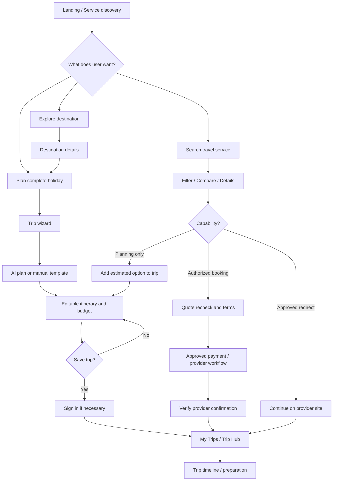
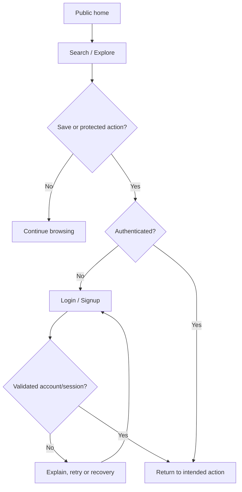
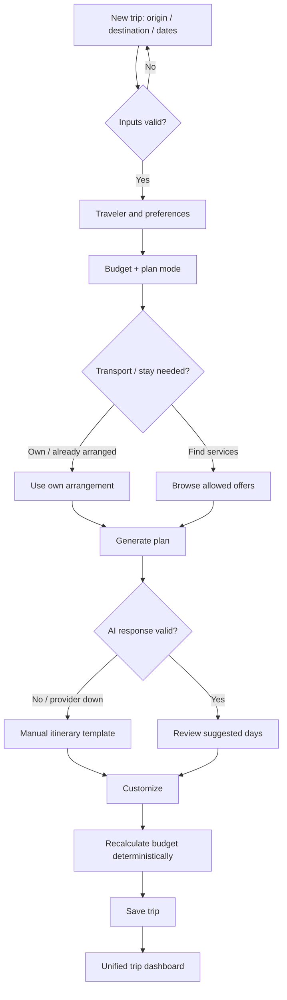
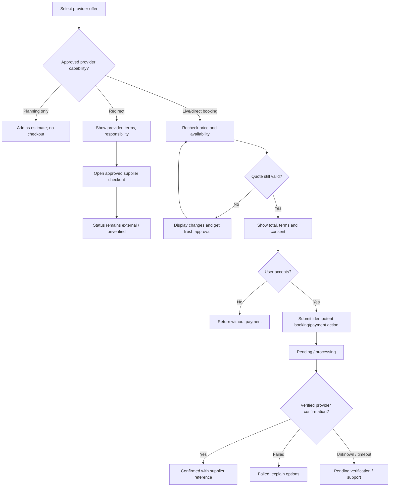

# GHOOMI — Application Flow, navigation and state specification

**Revision:** 1.0 • **Active release:** Partition 1 (pre-first-deployment) • **Basis:** latest 53-page Ghoomi working-platform master, section 40 initial page inventory, sections 58/79 future inventories. **The route map and state models below are implementation recommendations.**

## 1. Main mental model

Users may either **browse individual services** like an established booking platform or **build one complete holiday**. Both paths join at `My Trips`/`Trip Hub`. The site must keep the distinction among search results, selected itinerary items, requested bookings and confirmed provider reservations.

> A provider redirect alone must not mark a booking confirmed inside Ghoomi. A real confirmation is a verified provider event or supported supplier reference synchronized through an authorized mechanism.

## 2. Information architecture and suggested canonical routes

| Level | Route family | Notes |
|---|---|---|
| Public | `/`, `/destinations`, `/destinations/[slug]`, `/flights`, `/trains`, `/buses`, `/cabs`, `/stays`, `/restaurants`, `/activities` | Discoverability without auth; save requires auth |
| Account | `/signup`, `/login`, `/forgot-password`, `/verify`, `/account/profile`, `/account/travellers`, `/account/preferences` | Minimize PII |
| Trip planning | `/plan/new`, `/plan/[tripId]/travellers`, `/plan/[tripId]/preferences`, `/plan/[tripId]/itinerary`, `/plan/[tripId]/budget`, `/plan/[tripId]/customize` | Drafts server persisted; guard ownership |
| Private trips | `/my-trips`, `/trips/[tripId]`, `/trips/[tripId]/timeline`, `/trips/[tripId]/bookings` | Saved overview and itinerary; access checks |
| Service results | `/flights/results`, `/trains/results`, `/buses/results`, `/cabs/results`, `/stays/results` | Search criteria stored in query/state, not sensitive URL params |
| Service detail | `/flights/offer/[id]`, `/trains/offer/[id]`, `/buses/offer/[id]`, `/cabs/offer/[id]`, `/stays/[id]` | Provider-sourced content with provenance |
| Booking | `/checkout/[bookingIntentId]`, `/booking-status/[id]`, `/my-bookings`, `/my-bookings/[id]` | Only authorized integration; statuses never inferred |
| Safety/support | `/safety`, `/support`, `/support/tickets/[id]`, `/notifications` | Static help and verified support events |
| Admin | `/admin`, `/admin/users`, `/admin/trips`, `/admin/content`, `/admin/support`, `/admin/providers` | Role restricted |
| Future | `/groups`, `/family`, `/live-trip`, `/documents`, `/recovery`, `/back-to-home`, `/explore/community`, `/partners` | Disabled until later partition approval |

**Route caution:** canonical routes are a design proposal, not source document URL requirements; consolidate screen variants into components rather than creating 55 hardcoded routes.

## 3. Partition 1 journey sequences

### F-01 — Visitor discovery and account access (`GHO-P1-HOME`, `GHO-P1-AUTH`)

1. Visitor loads the landing page with hero search and service tabs.
2. Visitor switches between destination, flight, train, bus, cab and hotel search; default fields update contextually.
3. A search can be completed anonymously. Selecting **Save Trip**, **Add to My Trips**, profile or protected booking action prompts login or signup with a post-auth return route.
4. User registers; email verification/password recovery follows configured policy. Failed verification remains retryable without exposing another user's existence.
5. Successful auth returns to the original intended page and preserves non-sensitive draft context, subject to validation.
6. If session expires, redirect to login without losing safely stored server data; no protected content remains cached for unauthorized users.

### F-02 — New holiday wizard (`GHO-P1-TRIP`, `GHO-P1-AI`)

**Recommended step order:** 1) Route/dates → 2) Traveler count/preferences → 3) Budget/mode → 4) Transport/stay choice or skip → 5) AI itinerary / manual → 6) Budget review → 7) Save / trip dashboard.

- Validate destination and route context on input. Start date cannot exceed end date; show timezone and expected trip days.
- Travelers include count, age category if genuinely useful, accessibility needs only with explanation/permission; no full identity collection during planning.
- Choose Budget/Balanced/Comfort/Custom, interests, pace, meal preferences and broad stay preferences.
- Choose **Own Vehicle** or **Already Have Stay** to bypass a product search stage without blocking itinerary.
- AI request is made on server with a unique run ID. Responses are suggestions; validate date coverage, places, schedule, missing source data and budget; render `Suggested` status.
- Provide `Generate again`, `Modify preferences`, `Build manually`, `Edit day` and `Restore previous version` where versioning exists.
- Save creates/updates user-owned trip; return to `/trips/[id]`. Draft remains resumable.

### F-03 — Mode selection, comparison and review (`GHO-P1-TRANSPORT`, `GHO-P1-STAY`)

Users search each category using its own validated criteria, see loading and empty states, filter/sort known attributes and inspect source/quote/cancellation terms. If a provider is not authorized or data is stale, disclose it, allow a planning-only selection if useful, and never manufacture seats/rooms.

| Category | Search fields | Results/detailed cards | Allowed alternatives |
|---|---|---|---|
| Flights | From, to, departure/return, passengers | Carrier, stops, timing, baggage/conditions, price/status | Real supplier result or planning-only guidance |
| Trains | Stations, date, class/passengers where supported | Train, scheduled stops, class, fare/availability provenance | Approved rail booking link or timetable-only, never fake issuance |
| Buses | Route/date/passengers | Operator, coach type, boarding/drop, duration/terms | Verified provider handoff or no-results |
| Cabs | Pickup/drop, date/time, service type | Vehicle, trip type, price estimate or verified quote | Own vehicle or provider link |
| Hotels/stays | Destination, dates, guests/rooms | Property, room, amenities, location, fees/cancellation and quote | Already have stay, no-booking accommodation |

Flow: search → validate → request provider adapters / curated catalog → normalize + tag source/freshness → results → filter/sort → detail → add to plan OR authorized booking handoff. Selection is not payment.

### F-04 — Itinerary editor and budget (`GHO-P1-EDIT`, `GHO-P1-BUDGET`)

1. User selects day and adds attraction, restaurant, transport segment, stay, note or custom activity.
2. Client optimistically previews changes only if rollback on failure is implemented; backend persists owned records with version checking.
3. If date/time conflicts are detected, highlight collision and offer auto-shift suggestion; never silently edit a confirmed booking.
4. Budget recalculates using stored line items and quote provenance. Distinguish estimated total, actual paid, user budget and remaining estimate.
5. A changed traveler count, mode, stay or itinerary triggers appropriate refreshed suggestions and quote-staleness warnings.
6. Save confirms successfully persisted version. On conflict, allow refresh/merge or explicit override by authorized owner.

### F-05 — Supported booking / redirect (`GHO-P1-BOOK`, `GHO-P1-PAY`)

- Payment success, booking success and refund status **must not** be derived from client-side navigation.
- An unknown timeout must stay pending, reconcile and prevent duplicate retry charges.
- External booking can be attached to a trip as `MANUAL_REFERENCE_UNVERIFIED` without claiming supplier confirmation.
- Confirmation screen requires provider evidence and reference; show support path for discrepancies.

### F-06 — My Trips / unified hub (`GHO-P1-HUB`)

1. User opens My Trips list: active/planned/completed/cancelled tabs where useful.
2. Opens a trip hub containing destination and dates, itinerary by day, planned transport/stay, current budget estimate, confirmed vs unverified bookings, quick access to safety and support.
3. User edits trip or goes to a selected service detail; updates reflect on return, with fresh provider quote warning when needed.
4. User may change `PLANNED` → `ACTIVE` only with validated business rules; no GPS tracking is implied.
5. End trip → `COMPLETED` after explicit action or documented lifecycle. Post-trip public sharing belongs to Partition 3.

### F-07 — Destination, food and activity discovery (`GHO-P1-DEST`, `GHO-P1-FOOD`, `GHO-P1-ACT`)

Destination → guide tabs `Overview`, `Places`, `Where to stay`, `Food`, `Activities`, `Travel tips` → relevant listing → details → **Add to itinerary**. Only use current hours, events and exact prices with a current verified source; otherwise label `Hours not verified` or `Cost estimated`.

### F-08 — Basic safety, notifications and support (`GHO-P1-SAFETY`, `GHO-P1-NOTIFY`, `GHO-P1-SUPPORT`)

- Safety centre: emergency contacts + edit/remove, trusted local emergency information, call/open externally where supported. No automated SOS dispatch.
- Notifications: account verification, trip save, provider-confirmed booking/payment events and support-ticket updates; failed send records delivery state, not a false sent indicator.
- Support: category → message → optional trip/booking link → create ticket → receive reference → view status → admin resolution. Sensitive tickets accessible only by owner and assigned admin/support.
- Admin: dashboard → authorized records/content/providers/tickets → audited operations; avoid access to raw private docs or location if not needed.

## 4. State machines and authorization

### 4.1 Trip states

`DRAFT → PLANNED → ACTIVE → COMPLETED`; `DRAFT/PLANNED/ACTIVE → CANCELLED` where allowed by business rules. Replanning a trip does **not** alter confirmed paid reservations without separate authorization. A cancelled trip is not automatically a cancelled supplier booking.

### 4.2 Booking states

`DRAFT_INTENT → PENDING → PROCESSING → CONFIRMED | FAILED | CANCELLED | UNKNOWN`, depending on verified supplier status. `REDIRECTED_EXTERNAL` and `MANUAL_REFERENCE_UNVERIFIED` are separate cases and **not** equivalent to `CONFIRMED`. Partition 2 adds modification/refund management.

### 4.3 Payment states

`NOT_STARTED → INITIATED → PENDING → SUCCEEDED | FAILED | UNKNOWN`; later `REFUND_REQUESTED → PARTIAL_REFUNDED | REFUNDED` only from verified gateway/provider events.

### 4.4 Access matrix

| Action | Public | Trip owner | Other signed-in user | Admin/support |
|---|---:|---:|---:|---|
| Explore public destinations | Yes | Yes | Yes | Yes |
| Edit trip | No | Yes | No | Only governed support workflow, not general default |
| View a user's bookings | No | Own | No | Role-scoped, audited |
| Edit official destination catalog | No | No | No | Content-authorized admin |
| Manage provider credentials | No | No | No | Restricted operations role, secrets never displayed |
| View future live location | No | Only with consent | No | Not available by default |

## 5. Error, loading and exceptional branches

| Situation | Required behavior |
|---|---|
| Missing/ambiguous destination | Validate and ask user to select a real result; don't produce false route data |
| Past/invalid dates; adults/children invalid | Inline correction, preserve entered values |
| AI timeout, invalid JSON or poor plan | Offer manual editor, prior version and safe retry; log request ID |
| Supplier timeout / rate limit | Isolate vendor failure, preserve criteria and other categories, show no-results vs unavailable correctly |
| Flight/hotel quote changed | Compare old/new totals and require fresh approval |
| Provider redirect user returns | `External checkout — not verified`; never fake confirmation |
| Payment response unknown | Keep `UNKNOWN/PENDING`; reconcile before retry; support link |
| Save conflict / network failure | Do not discard plan; show retry and version conflict controls |
| Unauthorized trip ID | No private content; return 403/404 according to security policy |
| Long-form mobile usage | Fixed progress indicator; accessible previous/next; preserve draft |
| Missing device location | Destination-based planning; V1 must not require GPS |
| Data source lacks opening hours | State `Not verified`, don't show `Open now` |
| No authorized booking mode | Show alternatives or planning-only guidance, not a fake checkout |

## 6. Partition 1 source page inventory → proposed route/component map

The master specifies **55 initial pages/modules**; the table below preserves each label and maps it to a practical route or component. Some rows intentionally reuse routes. A route is not necessarily a separate deployable page.

| # | Source page/module | Suggested route or component | Group |
|---:|---|---|---|
| 1 | Landing Page | `/` | Foundation |
| 2 | Sign Up | `/signup` | Foundation |
| 3 | Login | `/login` | Foundation |
| 4 | Forgot Password | `/forgot-password` | Foundation |
| 5 | Verification | `/verify` | Foundation |
| 6 | User Profile | `/account/profile` | Foundation |
| 7 | Main Dashboard | `/dashboard` | Foundation |
| 8 | Destination Search | `/destinations` | Trip/AI |
| 9 | Destination Details | `/destinations/[slug]` | Trip/AI |
| 10 | Create Trip | `/plan/new` | Trip/AI |
| 11 | Traveller Details | `/plan/[id]/travellers` | Trip/AI |
| 12 | AI Trip Planner | `/plan/[id]/preferences` | Trip/AI |
| 13 | AI Itinerary | `/plan/[id]/itinerary` | Trip/AI |
| 14 | Budget Estimation | `/plan/[id]/budget` | Trip/AI |
| 15 | Trip Customization | `/plan/[id]/customize` | Trip/AI |
| 16 | My Trips | `/my-trips` | Trip/AI |
| 17 | Unified Trip Dashboard | `/trips/[id]` | Trip/AI |
| 18 | Transportation Home | `/transport` | Transport |
| 19 | Flight Search | `/flights` | Transport |
| 20 | Flight Results | `/flights/results` | Transport |
| 21 | Flight Details | `/flights/offer/[id]` | Transport |
| 22 | Train Search | `/trains` | Transport |
| 23 | Train Results | `/trains/results` | Transport |
| 24 | Train Details | `/trains/offer/[id]` | Transport |
| 25 | Bus Search | `/buses` | Transport |
| 26 | Bus Results | `/buses/results` | Transport |
| 27 | Bus Details | `/buses/offer/[id]` | Transport |
| 28 | Cab Search | `/cabs` | Transport |
| 29 | Cab Results | `/cabs/results` | Transport |
| 30 | Cab Details | `/cabs/offer/[id]` | Transport |
| 31 | Own Vehicle | `/plan/[id]/preferences` (vehicle mode) | Transport |
| 32 | Hotel Search | `/stays` | Accommodation |
| 33 | Hotel Results | `/stays/results` | Accommodation |
| 34 | Hotel Details | `/stays/[id]` | Accommodation |
| 35 | Room Selection | `/stays/[id]` (rooms section) | Accommodation |
| 36 | Guest Details | `/checkout/[intentId]` when authorized | Accommodation |
| 37 | Hotel Booking Flow | `/checkout/[intentId]` when authorized | Accommodation |
| 38 | Hotel Confirmation | `/booking-status/[id]` if verified | Accommodation |
| 39 | Food Discovery | `/restaurants` | Food/activities |
| 40 | Restaurant Listing | `/restaurants` (results) | Food/activities |
| 41 | Restaurant Details | `/restaurants/[id]` | Food/activities |
| 42 | Activities | `/activities` | Food/activities |
| 43 | Activity Details | `/activities/[id]` | Food/activities |
| 44 | Destination Explore | `/destinations/[slug]` (explore tabs) | Food/activities |
| 45 | Booking Summary | `/checkout/[intentId]` (summary) | Operations |
| 46 | Payment | `/checkout/[intentId]` (provider payment step) | Operations |
| 47 | Payment Status | `/booking-status/[id]` (payment section) | Operations |
| 48 | Booking Confirmation | `/booking-status/[id]` | Operations |
| 49 | My Bookings | `/my-bookings` | Operations |
| 50 | Booking Details | `/my-bookings/[id]` | Operations |
| 51 | Basic Safety | `/safety` | Operations |
| 52 | Notifications | `/notifications` | Operations |
| 53 | Customer Support | `/support` | Operations |
| 54 | Admin Dashboard | `/admin` | Operations |
| 55 | Partner Management | `/admin/providers` | Operations |

## 7. Partition 2 future journeys (do not activate in V1)

- Expanded booking intent → provider inventory recheck → payment → webhook verification → booking status/reconciliation → change/cancellation → refund tracking.
- Organizer invites member → member accepts → role-specific itinerary access → activity updates; no unbounded personal-data access.
- Traveler creates trusted-contact sharing permission → recipient verification → explicit start/expiry → revocation; show last known location/time if technically available and permission allows.
- Provider lists authorized inventory → approval → customer search → supplier event → partner/admin reporting.

### Partition 2 22 source pages/modules

1. Advanced Booking Dashboard; 2. Booking Modification Page; 3. Cancellation Management; 4. Refund Dashboard; 5. Payment Management; 6. Transaction Details; 7. Group Travel Dashboard; 8. Group Members Page; 9. Family Monitoring Dashboard; 10. Location Sharing Settings; 11. Live Trip Dashboard; 12. Trip Timeline; 13. Document Upload Page; 14. Document Management Page; 15. Notification Settings; 16. Advanced Support Page; 17. Partner Dashboard; 18. Partner Inventory Page; 19. Partner Booking Page; 20. Advanced Admin Dashboard; 21. Commission Management; 22. API Monitoring Dashboard.

## 8. Partition 3 future journeys (do not activate in V1)

- Disruption detected from verified source → impact graph → options and cost → user approval → supported execution → updated trip; unsupported operations remain guidance only.
- Back-to-Home → discover current situation (with permission) → evaluate existing bookings → estimate penalties/refunds → return alternatives → user approves individual paid changes → status monitoring.
- SOS → user confirms activation as appropriate → authorized contacts/official-service guidance → verified notification delivery → incident history. Never promise a rescue team is dispatched absent contracts/integration.
- Trip completed → user selects public visibility and strips sensitive/private information → publish itinerary/photos → moderation → others browse or clone as their own draft.

### Partition 3 22 source pages/modules

1. Intelligent Trip Recovery Dashboard; 2. Alternative Search Page; 3. Recovery Cost Page; 4. Back-to-Home Dashboard; 5. Return Booking Page; 6. Safety Centre; 7. SOS Dashboard; 8. Trusted Contacts Page; 9. Advanced AI Assistant; 10. Event Discovery Page; 11. Weather Intelligence Page; 12. Group Expense Dashboard; 13. Offline Travel Page; 14. Secure Document Wallet; 15. Ghoomi Explore; 16. Travel Memories Page; 17. Community Page; 18. Public Trip Details; 19. Premium Membership Page; 20. Advanced Partner Marketplace; 21. Partner Analytics; 22. Advanced Admin Analytics.

## 9. Flow test matrix and release gates

| Test ID | Scenario | Expected result |
|---|---|---|
| `FLOW-01` | Anonymous discovery → sign-in → saved trip | Return context preserved, own trip persists |
| `FLOW-02` | New 5-day holiday → AI → edit → estimate | Valid days; correct budget; persisted revision |
| `FLOW-03` | AI unavailable | Manual plan remains useful, saves |
| `FLOW-04` | Own vehicle + own stay | Bypass checkout steps; valid trip and cost plan |
| `FLOW-05` | Supplier timeout | Honest unavailable state; other functions remain accessible |
| `FLOW-06` | Redirect to external checkout | Status stays unverified without authoritative provider proof |
| `FLOW-07` | Direct booking timeout | `PENDING/UNKNOWN`, no duplicate submission |
| `FLOW-08` | Quote amount changes | Reprice disclosed and user must approve |
| `FLOW-09` | Other account requests trip UUID | Unauthorized result; no private data leaked |
| `FLOW-10` | Mobile + keyboard account/trip flow | Accessible operations and validation feedback |
| `FLOW-11` | Support ticket creation → admin | Owner/admin see appropriate ticket; others cannot |
| `FLOW-12` | Return to saved trip after restart | Latest saved state and correct booking labels |

The master lists what the product should do; the above flows make it measurable. For visual treatment refer to `Ui/Ux design Brief.md`, for API/schema refer to `trd.md`/`Backend Schema.md`, and for implementation status refer to `tracker.md`.
