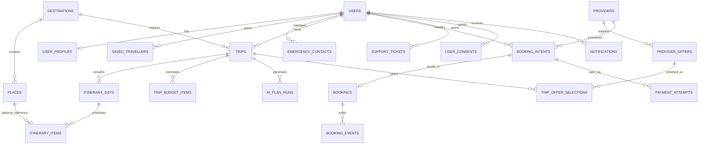

# GHOOMI — Backend Database Schema and Data Contracts

**Revision:** 1.1 — MySQL edition | **Current:** Partition 1 (pre-first-deployment) | **Source:** latest 53-page master PDF sections 41, 83–89, with business workflow sections 17–38. This is a **proposed MySQL 8.4 LTS implementation schema**, not a schema already deployed. It must be adapted after inspecting the actual codebase and using the user-approved MySQL database selection recorded as `ADR-001` in `memory.md`.

## 1. Modeling principles

- Relational source of truth with app-generated UUID identifiers stored as `CHAR(36)` ASCII/binary-collated primary keys, foreign keys, constraints, indexes, auditability, reversible versioned migrations, and per-user/server-side authorization.
- **Core trip records are independent of supplier inventory.** A trip can exist even when every service is in planning-only mode.
- **No fabricated financial or booking truth.** Store supplier offers as source-tagged snapshots with verification and expiry, not permanent inventory guarantees. Booking confirmation is separate from payment success and the itinerary selection.
- **Money uses BIGINT integer minor units** plus ISO 4217 currency (e.g., `INR` and paise). Don't store price in floating-point; don't apply unknown taxes or fees automatically.
- **Timestamps** use MySQL `DATETIME(6)` storing UTC by explicit backend/JDBC contract (the column does not store timezone offsets); local trip dates/times use `DATE`/`TIME` plus an IANA timezone. Configure JDBC/session timezone to UTC. Do not lose timezone at provider boundaries.
- **PII by necessity only.** Profiles/saved travelers should not include government IDs by default. Secure documents, location history and group family monitoring are deferred to later partitions.
- **Status transitions** are validated in service code and events; DB `CHECK` constraints help prevent impossible values.
- `updated_at` fields must be set by service/repository (or a reviewed trigger) consistently.

## 2. Entity relationship model



### 2.1 Partition 1 core tables and ownership

| ID | Table | Primary relation / purpose | PII / special rule |
|---|---|---|---|
| `DB-01` | `users` | Account, auth and role | Email/hash private; hashed password only |
| `DB-02` | `user_profiles` | Preferences and display name | User-scoped |
| `DB-03` | `saved_travellers` | Optional reusable travelers | Minimize age/contact details |
| `DB-04` | `emergency_contacts` | Basic traveler emergency list | Not automatically verified or alerted |
| `DB-05` | `destinations` | Curated geography and content | Licensed editorial metadata |
| `DB-06` | `places` | Attractions, food/activities | Hours/prices only when sourced |
| `DB-07` | `providers` | Supplier capabilities/contract state | Credential *references* only |
| `DB-08` | `provider_offers` | Normalized, expiring supplier snapshots | Source/time/availability status mandatory |
| `DB-09` | `trips` | Owner's complete plan summary | Row-level owner check |
| `DB-10` | `itinerary_days` | One trip's day schedule | Day unique within trip |
| `DB-11` | `itinerary_items` | Ordered itinerary components | Planned != booked |
| `DB-12` | `trip_budget_items` | Deterministic estimated line items | Paise, currency, cost-type provenance |
| `DB-13` | `trip_offer_selections` | Saved offers/own-service options | Selected != confirmed |
| `DB-14` | `ai_plan_runs` | AI orchestration status and metadata | Avoid raw secrets or excessive PII |
| `DB-15` | `booking_intents` | Checkout request and idempotency | Require provider approval |
| `DB-16` | `bookings` | Supplier-evidenced reservation status | External unverified is not confirmation |
| `DB-17` | `booking_events` | Provider booking lifecycle events | Deduped where event ID exists |
| `DB-18` | `payment_attempts` | Gateway actions with verified status | Never store card number/CVV |
| `DB-19` | `webhook_receipts` | Authenticity/deduplication/retry | Store payload hash, not secret raw body |
| `DB-20` | `notifications` | User message/delivery status | No invented provider alerts |
| `DB-21` | `support_tickets` | Customer complaint/issue record | Owner/assigned-staff only |
| `DB-22` | `safety_resources` | Official emergency directory | Source and source verification date |
| `DB-23` | `user_consents` | Terms/privacy notices and future grants | Version, purpose and withdrawal |
| `DB-24` | `audit_logs` | High-risk admin/financial/config operations | Redact sensitive payloads |

## 3. Reference MySQL 8.4 LTS DDL — Partition 1

The DDL is an **initial reference migration for a fresh MySQL 8.4 LTS database using InnoDB**. It is a specification, not evidence of an applied migration. MySQL-specific design: `CHAR(36)` UUID strings are generated by Java before insert; `JSON DEFAULT (JSON_OBJECT())` is supported using expression defaults; `DATETIME(6)` is normalized to UTC by the application; MySQL `CHECK` constraints and actual table-level foreign keys are used. `VARCHAR` is used on indexed string columns; duplicate nullable provider references use ordinary `UNIQUE` indexes because MySQL allows multiple `NULL`s. Validate this SQL against the chosen **actual MySQL server version** and an empty non-production database before deploying, then create versioned Flyway migrations. Do not implement undefined lifecycle transitions merely because a value exists.

```sql
-- Ghoomi Partition 1 reference schema (MySQL 8.4 LTS / InnoDB).
-- Generate UUIDs in Java (UUID.randomUUID().toString()); persist as CHAR(36) ASCII BINARY collation.
-- All DATETIME(6) values are UTC by application contract. Set JDBC connectionTimeZone=UTC and configure UTC session time zone.
-- Flyway should manage versioned migrations. Run only on a fresh development/staging database after review.
-- Do not disable FOREIGN_KEY_CHECKS for normal application writes.
SET time_zone = '+00:00';

CREATE TABLE users (
  id CHAR(36) CHARACTER SET ascii COLLATE ascii_bin PRIMARY KEY,
  email VARCHAR(254) COLLATE utf8mb4_0900_ai_ci NOT NULL UNIQUE,
  password_hash VARCHAR(255) NOT NULL,
  email_verified_at DATETIME(6),
  role VARCHAR(191) NOT NULL DEFAULT 'USER' CHECK (role IN ('USER','SUPPORT','ADMIN','SUPER_ADMIN')),
  is_active TINYINT(1) NOT NULL DEFAULT TRUE,
  created_at DATETIME(6) NOT NULL DEFAULT CURRENT_TIMESTAMP(6),
  updated_at DATETIME(6) NOT NULL DEFAULT CURRENT_TIMESTAMP(6)
) ENGINE=InnoDB DEFAULT CHARSET=utf8mb4 COLLATE=utf8mb4_0900_ai_ci;

CREATE TABLE user_profiles (
  user_id CHAR(36) CHARACTER SET ascii COLLATE ascii_bin PRIMARY KEY,
  display_name VARCHAR(150) NOT NULL,
  phone_e164 VARCHAR(20),
  travel_preferences JSON NOT NULL DEFAULT (JSON_OBJECT()),
  avatar_object_key TEXT,
  updated_at DATETIME(6) NOT NULL DEFAULT CURRENT_TIMESTAMP(6),
  CONSTRAINT fk_user_profiles_user_id FOREIGN KEY (user_id) REFERENCES users(id) ON DELETE CASCADE
) ENGINE=InnoDB DEFAULT CHARSET=utf8mb4 COLLATE=utf8mb4_0900_ai_ci;

CREATE TABLE saved_travellers (
  id CHAR(36) CHARACTER SET ascii COLLATE ascii_bin PRIMARY KEY,
  owner_user_id CHAR(36) CHARACTER SET ascii COLLATE ascii_bin NOT NULL,
  display_name VARCHAR(150) NOT NULL,
  age_category VARCHAR(191) CHECK (age_category IN ('CHILD','ADULT','SENIOR','UNSPECIFIED')),
  notes TEXT,
  created_at DATETIME(6) NOT NULL DEFAULT CURRENT_TIMESTAMP(6),
  CONSTRAINT fk_saved_travellers_owner_user_id FOREIGN KEY (owner_user_id) REFERENCES users(id) ON DELETE CASCADE
) ENGINE=InnoDB DEFAULT CHARSET=utf8mb4 COLLATE=utf8mb4_0900_ai_ci;

CREATE TABLE emergency_contacts (
  id CHAR(36) CHARACTER SET ascii COLLATE ascii_bin PRIMARY KEY,
  owner_user_id CHAR(36) CHARACTER SET ascii COLLATE ascii_bin NOT NULL,
  contact_name VARCHAR(150) NOT NULL,
  contact_phone_e164 VARCHAR(20) NOT NULL,
  relationship_label VARCHAR(100),
  verified_at DATETIME(6),
  created_at DATETIME(6) NOT NULL DEFAULT CURRENT_TIMESTAMP(6),
  CONSTRAINT fk_emergency_contacts_owner_user_id FOREIGN KEY (owner_user_id) REFERENCES users(id) ON DELETE CASCADE
) ENGINE=InnoDB DEFAULT CHARSET=utf8mb4 COLLATE=utf8mb4_0900_ai_ci;

CREATE TABLE destinations (
  id CHAR(36) CHARACTER SET ascii COLLATE ascii_bin PRIMARY KEY,
  slug VARCHAR(160) NOT NULL UNIQUE,
  name VARCHAR(200) NOT NULL,
  state_region VARCHAR(150),
  country_code CHAR(2) NOT NULL,
  latitude DECIMAL(9,6),
  longitude DECIMAL(9,6),
  summary TEXT,
  content_source TEXT,
  image_license_ref TEXT,
  active TINYINT(1) NOT NULL DEFAULT TRUE,
  updated_at DATETIME(6) NOT NULL DEFAULT CURRENT_TIMESTAMP(6)
) ENGINE=InnoDB DEFAULT CHARSET=utf8mb4 COLLATE=utf8mb4_0900_ai_ci;

CREATE TABLE places (
  id CHAR(36) CHARACTER SET ascii COLLATE ascii_bin PRIMARY KEY,
  destination_id CHAR(36) CHARACTER SET ascii COLLATE ascii_bin,
  name VARCHAR(200) NOT NULL,
  category VARCHAR(60) NOT NULL CHECK (category IN ('ATTRACTION','RESTAURANT','ACTIVITY','OTHER')),
  address_label TEXT,
  latitude DECIMAL(9,6),
  longitude DECIMAL(9,6),
  description TEXT,
  source_name VARCHAR(180),
  source_url TEXT,
  info_verified_at DATETIME(6),
  opening_hours JSON,
  estimated_cost_minor BIGINT CHECK (estimated_cost_minor >= 0),
  currency CHAR(3),
  active TINYINT(1) NOT NULL DEFAULT TRUE,
  CONSTRAINT fk_places_destination_id FOREIGN KEY (destination_id) REFERENCES destinations(id) ON DELETE SET NULL
) ENGINE=InnoDB DEFAULT CHARSET=utf8mb4 COLLATE=utf8mb4_0900_ai_ci;

CREATE TABLE providers (
  id CHAR(36) CHARACTER SET ascii COLLATE ascii_bin PRIMARY KEY,
  code VARCHAR(80) COLLATE utf8mb4_0900_bin NOT NULL UNIQUE,
  name VARCHAR(200) NOT NULL,
  vertical VARCHAR(32) NOT NULL CHECK (vertical IN ('FLIGHT','TRAIN','BUS','CAB','STAY','ACTIVITY','MAP','PAYMENT')),
  capability VARCHAR(40) NOT NULL DEFAULT 'PLANNING_ONLY'
    CHECK (capability IN ('PLANNING_ONLY','REDIRECT','LIVE_SEARCH_EXTERNAL_CHECKOUT','DIRECT_BOOKING')),
  authorization_status VARCHAR(25) NOT NULL DEFAULT 'UNVERIFIED'
    CHECK (authorization_status IN ('UNVERIFIED','UNDER_REVIEW','APPROVED','SUSPENDED')),
  credentials_ref VARCHAR(255), -- secret-manager reference only
  terms_url TEXT,
  enabled TINYINT(1) NOT NULL DEFAULT FALSE,
  updated_at DATETIME(6) NOT NULL DEFAULT CURRENT_TIMESTAMP(6)
) ENGINE=InnoDB DEFAULT CHARSET=utf8mb4 COLLATE=utf8mb4_0900_ai_ci;

CREATE TABLE provider_offers (
  id CHAR(36) CHARACTER SET ascii COLLATE ascii_bin PRIMARY KEY,
  provider_id CHAR(36) CHARACTER SET ascii COLLATE ascii_bin NOT NULL,
  provider_offer_key VARCHAR(160) COLLATE utf8mb4_0900_bin NOT NULL,
  vertical VARCHAR(32) NOT NULL,
  name VARCHAR(200) NOT NULL,
  details JSON NOT NULL DEFAULT (JSON_OBJECT()),
  origin_label VARCHAR(200),
  destination_label VARCHAR(200),
  starts_at DATETIME(6),
  ends_at DATETIME(6),
  price_minor BIGINT CHECK (price_minor >= 0),
  currency CHAR(3),
  price_basis VARCHAR(24) CHECK (price_basis IN ('PER_PERSON','PER_GROUP','PER_ROOM','TOTAL','UNKNOWN')),
  data_status VARCHAR(24) NOT NULL CHECK (data_status IN ('VERIFIED_LIVE','PROVIDER_LISTED','ESTIMATED','UNAVAILABLE')),
  checked_at DATETIME(6) NOT NULL,
  valid_until DATETIME(6),
  terms_url TEXT,
  redirect_url TEXT,
  created_at DATETIME(6) NOT NULL DEFAULT CURRENT_TIMESTAMP(6),
  UNIQUE(provider_id, provider_offer_key, checked_at),
  CONSTRAINT fk_provider_offers_provider_id FOREIGN KEY (provider_id) REFERENCES providers(id)
) ENGINE=InnoDB DEFAULT CHARSET=utf8mb4 COLLATE=utf8mb4_0900_ai_ci;

CREATE TABLE trips (
  id CHAR(36) CHARACTER SET ascii COLLATE ascii_bin PRIMARY KEY,
  owner_user_id CHAR(36) CHARACTER SET ascii COLLATE ascii_bin NOT NULL,
  destination_id CHAR(36) CHARACTER SET ascii COLLATE ascii_bin,
  title VARCHAR(255) NOT NULL,
  origin_label VARCHAR(200) NOT NULL,
  destination_label VARCHAR(200) NOT NULL,
  start_date DATE NOT NULL,
  end_date DATE NOT NULL,
  timezone VARCHAR(64) NOT NULL DEFAULT 'Asia/Kolkata',
  traveler_count INTEGER NOT NULL CHECK (traveler_count > 0 AND traveler_count <= 50),
  plan_mode VARCHAR(16) NOT NULL DEFAULT 'BALANCED'
    CHECK (plan_mode IN ('BUDGET','BALANCED','COMFORT','CUSTOM')),
  target_budget_minor BIGINT CHECK (target_budget_minor >= 0),
  currency CHAR(3) NOT NULL DEFAULT 'INR',
  own_vehicle TINYINT(1) NOT NULL DEFAULT FALSE,
  already_have_stay TINYINT(1) NOT NULL DEFAULT FALSE,
  preferences JSON NOT NULL DEFAULT (JSON_OBJECT()),
  status VARCHAR(35) NOT NULL DEFAULT 'DRAFT'
    CHECK (status IN ('DRAFT','PLANNED','ACTIVE','COMPLETED','CANCELLED')),
  version INTEGER NOT NULL DEFAULT 1 CHECK (version >= 1),
  created_at DATETIME(6) NOT NULL DEFAULT CURRENT_TIMESTAMP(6),
  updated_at DATETIME(6) NOT NULL DEFAULT CURRENT_TIMESTAMP(6),
  CHECK (end_date >= start_date),
  CONSTRAINT fk_trips_owner_user_id FOREIGN KEY (owner_user_id) REFERENCES users(id),
  CONSTRAINT fk_trips_destination_id FOREIGN KEY (destination_id) REFERENCES destinations(id) ON DELETE SET NULL
) ENGINE=InnoDB DEFAULT CHARSET=utf8mb4 COLLATE=utf8mb4_0900_ai_ci;

CREATE TABLE itinerary_days (
  id CHAR(36) CHARACTER SET ascii COLLATE ascii_bin PRIMARY KEY,
  trip_id CHAR(36) CHARACTER SET ascii COLLATE ascii_bin NOT NULL,
  day_date DATE NOT NULL,
  day_index INTEGER NOT NULL CHECK (day_index >= 1),
  title VARCHAR(255),
  UNIQUE(trip_id,day_date),
  UNIQUE(trip_id,day_index),
  CONSTRAINT fk_itinerary_days_trip_id FOREIGN KEY (trip_id) REFERENCES trips(id) ON DELETE CASCADE
) ENGINE=InnoDB DEFAULT CHARSET=utf8mb4 COLLATE=utf8mb4_0900_ai_ci;

CREATE TABLE itinerary_items (
  id CHAR(36) CHARACTER SET ascii COLLATE ascii_bin PRIMARY KEY,
  itinerary_day_id CHAR(36) CHARACTER SET ascii COLLATE ascii_bin NOT NULL,
  place_id CHAR(36) CHARACTER SET ascii COLLATE ascii_bin,
  item_order INTEGER NOT NULL CHECK (item_order >= 0),
  category VARCHAR(60) NOT NULL,
  title VARCHAR(255) NOT NULL,
  planned_start TIME,
  planned_end TIME,
  notes TEXT,
  estimate_minor BIGINT CHECK (estimate_minor >= 0),
  currency CHAR(3),
  verification_status VARCHAR(32) NOT NULL DEFAULT 'USER_PLANNED'
    CHECK (verification_status IN ('USER_PLANNED','AI_SUGGESTED','PROVIDER_LISTED','VERIFIED')),
  source_ref TEXT,
  created_at DATETIME(6) NOT NULL DEFAULT CURRENT_TIMESTAMP(6),
  UNIQUE(itinerary_day_id,item_order),
  CONSTRAINT fk_itinerary_items_itinerary_day_id FOREIGN KEY (itinerary_day_id) REFERENCES itinerary_days(id) ON DELETE CASCADE,
  CONSTRAINT fk_itinerary_items_place_id FOREIGN KEY (place_id) REFERENCES places(id) ON DELETE SET NULL
) ENGINE=InnoDB DEFAULT CHARSET=utf8mb4 COLLATE=utf8mb4_0900_ai_ci;

CREATE TABLE trip_budget_items (
  id CHAR(36) CHARACTER SET ascii COLLATE ascii_bin PRIMARY KEY,
  trip_id CHAR(36) CHARACTER SET ascii COLLATE ascii_bin NOT NULL,
  category VARCHAR(60) NOT NULL CHECK (category IN ('TRANSPORT','STAY','FOOD','LOCAL_TRAVEL','ACTIVITY','FEES','EMERGENCY_RESERVE','OTHER')),
  title VARCHAR(255) NOT NULL,
  amount_minor BIGINT NOT NULL CHECK (amount_minor >= 0),
  currency CHAR(3) NOT NULL,
  basis VARCHAR(24) NOT NULL DEFAULT 'TOTAL' CHECK (basis IN ('TOTAL','PER_PERSON','PER_NIGHT','PER_UNIT')),
  price_status VARCHAR(28) NOT NULL DEFAULT 'ESTIMATED'
    CHECK (price_status IN ('ESTIMATED','PROVIDER_QUOTED','USER_ENTERED','PAID_VERIFIED')),
  source_ref TEXT,
  checked_at DATETIME(6),
  updated_at DATETIME(6) NOT NULL DEFAULT CURRENT_TIMESTAMP(6),
  CONSTRAINT fk_trip_budget_items_trip_id FOREIGN KEY (trip_id) REFERENCES trips(id) ON DELETE CASCADE
) ENGINE=InnoDB DEFAULT CHARSET=utf8mb4 COLLATE=utf8mb4_0900_ai_ci;

CREATE TABLE trip_offer_selections (
  id CHAR(36) CHARACTER SET ascii COLLATE ascii_bin PRIMARY KEY,
  trip_id CHAR(36) CHARACTER SET ascii COLLATE ascii_bin NOT NULL,
  provider_offer_id CHAR(36) CHARACTER SET ascii COLLATE ascii_bin,
  selection_kind VARCHAR(28) NOT NULL CHECK (selection_kind IN ('SUPPLIER_OFFER','OWN_VEHICLE','OWN_STAY','CUSTOM')),
  vertical VARCHAR(32) NOT NULL,
  title VARCHAR(255) NOT NULL,
  booking_state VARCHAR(32) NOT NULL DEFAULT 'PLANNED'
    CHECK (booking_state IN ('PLANNED','REDIRECTED_EXTERNAL','MANUAL_REFERENCE_UNVERIFIED','CONFIRMED','CANCELLED')),
  created_at DATETIME(6) NOT NULL DEFAULT CURRENT_TIMESTAMP(6),
  CONSTRAINT fk_trip_offer_selections_trip_id FOREIGN KEY (trip_id) REFERENCES trips(id) ON DELETE CASCADE,
  CONSTRAINT fk_trip_offer_selections_provider_offer_id FOREIGN KEY (provider_offer_id) REFERENCES provider_offers(id) ON DELETE SET NULL
) ENGINE=InnoDB DEFAULT CHARSET=utf8mb4 COLLATE=utf8mb4_0900_ai_ci;

CREATE TABLE ai_plan_runs (
  id CHAR(36) CHARACTER SET ascii COLLATE ascii_bin PRIMARY KEY,
  trip_id CHAR(36) CHARACTER SET ascii COLLATE ascii_bin NOT NULL,
  requested_by CHAR(36) CHARACTER SET ascii COLLATE ascii_bin NOT NULL,
  run_scope VARCHAR(32) NOT NULL CHECK (run_scope IN ('WHOLE_TRIP','SINGLE_DAY')),
  model_ref VARCHAR(100),
  status VARCHAR(35) NOT NULL CHECK (status IN ('PENDING','SUCCEEDED','FAILED','VALIDATION_REJECTED')),
  request_context_hash VARCHAR(128) COLLATE utf8mb4_0900_bin,
  duration_ms INTEGER,
  error_code VARCHAR(80),
  created_at DATETIME(6) NOT NULL DEFAULT CURRENT_TIMESTAMP(6),
  completed_at DATETIME(6),
  CONSTRAINT fk_ai_plan_runs_trip_id FOREIGN KEY (trip_id) REFERENCES trips(id) ON DELETE CASCADE,
  CONSTRAINT fk_ai_plan_runs_requested_by FOREIGN KEY (requested_by) REFERENCES users(id)
) ENGINE=InnoDB DEFAULT CHARSET=utf8mb4 COLLATE=utf8mb4_0900_ai_ci;

CREATE TABLE booking_intents (
  id CHAR(36) CHARACTER SET ascii COLLATE ascii_bin PRIMARY KEY,
  user_id CHAR(36) CHARACTER SET ascii COLLATE ascii_bin NOT NULL,
  trip_id CHAR(36) CHARACTER SET ascii COLLATE ascii_bin,
  provider_id CHAR(36) CHARACTER SET ascii COLLATE ascii_bin NOT NULL,
  offer_id CHAR(36) CHARACTER SET ascii COLLATE ascii_bin,
  idempotency_key VARCHAR(128) COLLATE utf8mb4_0900_bin NOT NULL,
  capability VARCHAR(40) NOT NULL CHECK (capability IN ('REDIRECT','LIVE_SEARCH_EXTERNAL_CHECKOUT','DIRECT_BOOKING')),
  status VARCHAR(35) NOT NULL CHECK (status IN ('DRAFT_INTENT','REDIRECTED_EXTERNAL','PENDING','PROCESSING','CONFIRMED','FAILED','UNKNOWN','CANCELLED')),
  quoted_amount_minor BIGINT CHECK (quoted_amount_minor >= 0),
  currency CHAR(3),
  quote_expires_at DATETIME(6),
  terms_accepted_at DATETIME(6),
  created_at DATETIME(6) NOT NULL DEFAULT CURRENT_TIMESTAMP(6),
  updated_at DATETIME(6) NOT NULL DEFAULT CURRENT_TIMESTAMP(6),
  UNIQUE(user_id,idempotency_key),
  CONSTRAINT fk_booking_intents_user_id FOREIGN KEY (user_id) REFERENCES users(id),
  CONSTRAINT fk_booking_intents_trip_id FOREIGN KEY (trip_id) REFERENCES trips(id) ON DELETE SET NULL,
  CONSTRAINT fk_booking_intents_provider_id FOREIGN KEY (provider_id) REFERENCES providers(id),
  CONSTRAINT fk_booking_intents_offer_id FOREIGN KEY (offer_id) REFERENCES provider_offers(id) ON DELETE SET NULL
) ENGINE=InnoDB DEFAULT CHARSET=utf8mb4 COLLATE=utf8mb4_0900_ai_ci;

CREATE TABLE bookings (
  id CHAR(36) CHARACTER SET ascii COLLATE ascii_bin PRIMARY KEY,
  booking_intent_id CHAR(36) CHARACTER SET ascii COLLATE ascii_bin NOT NULL UNIQUE,
  provider_id CHAR(36) CHARACTER SET ascii COLLATE ascii_bin NOT NULL,
  user_id CHAR(36) CHARACTER SET ascii COLLATE ascii_bin NOT NULL,
  trip_id CHAR(36) CHARACTER SET ascii COLLATE ascii_bin,
  provider_booking_ref VARCHAR(180) COLLATE utf8mb4_0900_bin,
  status VARCHAR(35) NOT NULL CHECK (status IN ('PENDING','PROCESSING','CONFIRMED','FAILED','CANCELLED','UNKNOWN','COMPLETED')),
  confirmed_at DATETIME(6),
  provider_evidence_ref TEXT,
  created_at DATETIME(6) NOT NULL DEFAULT CURRENT_TIMESTAMP(6),
  updated_at DATETIME(6) NOT NULL DEFAULT CURRENT_TIMESTAMP(6),
  CHECK (status <> 'CONFIRMED' OR (provider_booking_ref IS NOT NULL AND provider_evidence_ref IS NOT NULL)),
  CONSTRAINT fk_bookings_booking_intent_id FOREIGN KEY (booking_intent_id) REFERENCES booking_intents(id),
  CONSTRAINT fk_bookings_provider_id FOREIGN KEY (provider_id) REFERENCES providers(id),
  CONSTRAINT fk_bookings_user_id FOREIGN KEY (user_id) REFERENCES users(id),
  CONSTRAINT fk_bookings_trip_id FOREIGN KEY (trip_id) REFERENCES trips(id) ON DELETE SET NULL
) ENGINE=InnoDB DEFAULT CHARSET=utf8mb4 COLLATE=utf8mb4_0900_ai_ci;

CREATE TABLE booking_events (
  id CHAR(36) CHARACTER SET ascii COLLATE ascii_bin PRIMARY KEY,
  booking_id CHAR(36) CHARACTER SET ascii COLLATE ascii_bin NOT NULL,
  provider_event_ref VARCHAR(191) COLLATE utf8mb4_0900_bin,
  event_type VARCHAR(80) NOT NULL,
  source VARCHAR(80) NOT NULL,
  observed_at DATETIME(6) NOT NULL DEFAULT CURRENT_TIMESTAMP(6),
  safe_summary JSON NOT NULL DEFAULT (JSON_OBJECT()),
  CONSTRAINT fk_booking_events_booking_id FOREIGN KEY (booking_id) REFERENCES bookings(id)
) ENGINE=InnoDB DEFAULT CHARSET=utf8mb4 COLLATE=utf8mb4_0900_ai_ci;

CREATE TABLE payment_attempts (
  id CHAR(36) CHARACTER SET ascii COLLATE ascii_bin PRIMARY KEY,
  booking_intent_id CHAR(36) CHARACTER SET ascii COLLATE ascii_bin NOT NULL,
  user_id CHAR(36) CHARACTER SET ascii COLLATE ascii_bin NOT NULL,
  gateway_code VARCHAR(60) NOT NULL,
  idempotency_key VARCHAR(128) COLLATE utf8mb4_0900_bin NOT NULL,
  gateway_payment_ref VARCHAR(180) COLLATE utf8mb4_0900_bin,
  amount_minor BIGINT NOT NULL CHECK (amount_minor >= 0),
  currency CHAR(3) NOT NULL,
  status VARCHAR(35) NOT NULL CHECK (status IN ('NOT_STARTED','INITIATED','PENDING','SUCCEEDED','FAILED','UNKNOWN')),
  verified_at DATETIME(6),
  created_at DATETIME(6) NOT NULL DEFAULT CURRENT_TIMESTAMP(6),
  UNIQUE(user_id,idempotency_key),
  CONSTRAINT fk_payment_attempts_booking_intent_id FOREIGN KEY (booking_intent_id) REFERENCES booking_intents(id),
  CONSTRAINT fk_payment_attempts_user_id FOREIGN KEY (user_id) REFERENCES users(id)
) ENGINE=InnoDB DEFAULT CHARSET=utf8mb4 COLLATE=utf8mb4_0900_ai_ci;

CREATE TABLE webhook_receipts (
  id CHAR(36) CHARACTER SET ascii COLLATE ascii_bin PRIMARY KEY,
  source_code VARCHAR(60) NOT NULL,
  external_event_id VARCHAR(180) COLLATE utf8mb4_0900_bin NOT NULL,
  payload_hash VARCHAR(128) COLLATE utf8mb4_0900_bin NOT NULL,
  signature_valid TINYINT(1) NOT NULL DEFAULT FALSE,
  processing_status VARCHAR(24) NOT NULL DEFAULT 'RECEIVED'
    CHECK (processing_status IN ('RECEIVED','PROCESSED','FAILED','IGNORED')),
  received_at DATETIME(6) NOT NULL DEFAULT CURRENT_TIMESTAMP(6),
  processed_at DATETIME(6),
  UNIQUE(source_code,external_event_id)
) ENGINE=InnoDB DEFAULT CHARSET=utf8mb4 COLLATE=utf8mb4_0900_ai_ci;

CREATE TABLE notifications (
  id CHAR(36) CHARACTER SET ascii COLLATE ascii_bin PRIMARY KEY,
  user_id CHAR(36) CHARACTER SET ascii COLLATE ascii_bin NOT NULL,
  trip_id CHAR(36) CHARACTER SET ascii COLLATE ascii_bin,
  category VARCHAR(60) NOT NULL,
  title VARCHAR(255) NOT NULL,
  body TEXT NOT NULL,
  channel VARCHAR(32) NOT NULL DEFAULT 'IN_APP',
  delivery_status VARCHAR(30) NOT NULL DEFAULT 'PENDING'
    CHECK (delivery_status IN ('PENDING','SENT','DELIVERED','FAILED','NOT_APPLICABLE')),
  read_at DATETIME(6),
  created_at DATETIME(6) NOT NULL DEFAULT CURRENT_TIMESTAMP(6),
  CONSTRAINT fk_notifications_user_id FOREIGN KEY (user_id) REFERENCES users(id) ON DELETE CASCADE,
  CONSTRAINT fk_notifications_trip_id FOREIGN KEY (trip_id) REFERENCES trips(id) ON DELETE SET NULL
) ENGINE=InnoDB DEFAULT CHARSET=utf8mb4 COLLATE=utf8mb4_0900_ai_ci;

CREATE TABLE support_tickets (
  id CHAR(36) CHARACTER SET ascii COLLATE ascii_bin PRIMARY KEY,
  user_id CHAR(36) CHARACTER SET ascii COLLATE ascii_bin NOT NULL,
  trip_id CHAR(36) CHARACTER SET ascii COLLATE ascii_bin,
  booking_id CHAR(36) CHARACTER SET ascii COLLATE ascii_bin,
  assigned_staff_user_id CHAR(36) CHARACTER SET ascii COLLATE ascii_bin,
  category VARCHAR(60) NOT NULL,
  subject VARCHAR(200) NOT NULL,
  description TEXT NOT NULL,
  status VARCHAR(35) NOT NULL DEFAULT 'OPEN'
    CHECK (status IN ('OPEN','IN_REVIEW','WAITING_FOR_USER','RESOLVED','CLOSED')),
  created_at DATETIME(6) NOT NULL DEFAULT CURRENT_TIMESTAMP(6),
  updated_at DATETIME(6) NOT NULL DEFAULT CURRENT_TIMESTAMP(6),
  CONSTRAINT fk_support_tickets_user_id FOREIGN KEY (user_id) REFERENCES users(id),
  CONSTRAINT fk_support_tickets_trip_id FOREIGN KEY (trip_id) REFERENCES trips(id) ON DELETE SET NULL,
  CONSTRAINT fk_support_tickets_booking_id FOREIGN KEY (booking_id) REFERENCES bookings(id) ON DELETE SET NULL,
  CONSTRAINT fk_support_tickets_assigned_staff_user_id FOREIGN KEY (assigned_staff_user_id) REFERENCES users(id) ON DELETE SET NULL
) ENGINE=InnoDB DEFAULT CHARSET=utf8mb4 COLLATE=utf8mb4_0900_ai_ci;

CREATE TABLE safety_resources (
  id CHAR(36) CHARACTER SET ascii COLLATE ascii_bin PRIMARY KEY,
  country_code CHAR(2) NOT NULL,
  region_label VARCHAR(191),
  resource_type VARCHAR(64) NOT NULL,
  display_name VARCHAR(150) NOT NULL,
  phone_number VARCHAR(25),
  official_url TEXT,
  source_name VARCHAR(180) NOT NULL,
  verified_at DATETIME(6),
  active TINYINT(1) NOT NULL DEFAULT TRUE
) ENGINE=InnoDB DEFAULT CHARSET=utf8mb4 COLLATE=utf8mb4_0900_ai_ci;

CREATE TABLE user_consents (
  id CHAR(36) CHARACTER SET ascii COLLATE ascii_bin PRIMARY KEY,
  user_id CHAR(36) CHARACTER SET ascii COLLATE ascii_bin NOT NULL,
  consent_type VARCHAR(80) NOT NULL,
  document_version VARCHAR(64) NOT NULL,
  purpose VARCHAR(200),
  granted_at DATETIME(6) NOT NULL DEFAULT CURRENT_TIMESTAMP(6),
  withdrawn_at DATETIME(6),
  client_context JSON NOT NULL DEFAULT (JSON_OBJECT()),
  CONSTRAINT fk_user_consents_user_id FOREIGN KEY (user_id) REFERENCES users(id)
) ENGINE=InnoDB DEFAULT CHARSET=utf8mb4 COLLATE=utf8mb4_0900_ai_ci;

CREATE TABLE audit_logs (
  id CHAR(36) CHARACTER SET ascii COLLATE ascii_bin PRIMARY KEY,
  actor_user_id CHAR(36) CHARACTER SET ascii COLLATE ascii_bin,
  action VARCHAR(100) NOT NULL,
  object_type VARCHAR(80) NOT NULL,
  object_id CHAR(36) CHARACTER SET ascii COLLATE ascii_bin,
  request_id VARCHAR(120) COLLATE utf8mb4_0900_bin,
  safe_metadata JSON NOT NULL DEFAULT (JSON_OBJECT()),
  created_at DATETIME(6) NOT NULL DEFAULT CURRENT_TIMESTAMP(6),
  CONSTRAINT fk_audit_logs_actor_user_id FOREIGN KEY (actor_user_id) REFERENCES users(id) ON DELETE SET NULL
) ENGINE=InnoDB DEFAULT CHARSET=utf8mb4 COLLATE=utf8mb4_0900_ai_ci;

CREATE INDEX saved_travellers_owner_idx ON saved_travellers(owner_user_id);

CREATE INDEX emergency_contacts_owner_idx ON emergency_contacts(owner_user_id);

CREATE INDEX places_destination_cat_idx ON places(destination_id,category);

CREATE INDEX provider_offers_provider_checked_idx ON provider_offers(provider_id,checked_at DESC);

CREATE INDEX trips_owner_updated_idx ON trips(owner_user_id,updated_at DESC);

CREATE INDEX trips_status_start_idx ON trips(status,start_date);

CREATE INDEX itinerary_items_day_idx ON itinerary_items(itinerary_day_id,item_order);

CREATE INDEX trip_budget_items_trip_idx ON trip_budget_items(trip_id);

CREATE INDEX trip_offer_selections_trip_idx ON trip_offer_selections(trip_id);

CREATE INDEX ai_plan_runs_trip_created_idx ON ai_plan_runs(trip_id,created_at DESC);

CREATE INDEX booking_intents_trip_idx ON booking_intents(trip_id);

-- UNIQUE indexes in MySQL permit multiple NULL values; no partial WHERE required.
CREATE UNIQUE INDEX bookings_supplier_reference_uq ON bookings(provider_id,provider_booking_ref);

CREATE INDEX bookings_user_created_idx ON bookings(user_id,created_at DESC);

CREATE INDEX booking_events_booking_idx ON booking_events(booking_id,observed_at DESC);

CREATE UNIQUE INDEX payment_gateway_ref_uq ON payment_attempts(gateway_code,gateway_payment_ref);

CREATE INDEX notifications_user_created_idx ON notifications(user_id,created_at DESC);

CREATE INDEX support_tickets_owner_status_idx ON support_tickets(user_id,status);

CREATE INDEX user_consents_type_idx ON user_consents(user_id,consent_type,granted_at DESC);

CREATE INDEX audit_logs_object_idx ON audit_logs(object_type,object_id,created_at DESC);
```

### 3.1 Migration hardening required before real production

- Trip date `itinerary_days.day_date` must be checked against its parent trip dates **in service logic and integration tests** (cross-table constraints require triggers or guarded writes).
- Booking `CONFIRMED` requires valid supplier evidence, not just non-null text; enforce this in a verified adapter/event service, never let a client set that status.
- Booking/provider/user/trip foreign keys must be **cross-checked for same owner/provider** in transaction service; FK existence alone does not establish authorized relationships.
- `provider_offers` cache rows need a cleanup/retention job and the search process must not reuse expired inventory as live. Provider terms/rights decide permitted caching.
- `places`/`destinations` editorial data requires source/licensing/attribution and periodic review; empty `info_verified_at` means no live claim.
- Login sessions/tokens and password recovery tables depend on the selected session mechanism; **do not add authentication storage with conflicting security assumptions** until auth design approved.
- Implement proper state-transition services, optimistic locking on trip version and audit logs for sensitive changes.
- Review `ON DELETE` rules for financial records and applicable retention obligations. Retained payment/booking records should not be cascade-deleted by user deletion; use compliant pseudonymization/erasure workflows.
- Add appropriate constraints on text length, currencies, phone normalization, time order and relationship consistency at service/DB boundary; test invalid and boundary cases.

### 3.2 JDBC/JPA mapping note (MySQL)

Map Java UUIDs explicitly to the string `CHAR(36)` representation (for Hibernate 6, an explicit VARCHAR JDBC type strategy such as `@JdbcTypeCode(SqlTypes.VARCHAR)` or equivalent tested converter may be needed; do not assume Hibernate's default UUID binding uses the same physical representation). Ensure application-level UTC normalization; use binary collation for machine identifiers and test exact-case idempotency matching. Check JSON default expressions on the deployed server version.

## 4. Normalized data behavior and invariants

### `DB-AUTH`: Users and traveler ownership

- Every saved traveler, emergency contact, profile, trip, support ticket and notification has an owner or explicit staff permission. User B cannot fetch user A's rows even by supplying IDs.
- Sensitive contact details encrypted at rest as infrastructure supports, omitted from logs and analytics.
- Admin role is server-side; never use a client-provided `role` claim as the sole privilege source.

### `DB-TRIP`: Trip, version and itinerary

- `trips.version` increments on saved mutation. `PATCH /trips/{id}` verifies `If-Match`/version to prevent lost edits.
- Day indexes are contiguous and unique per trip; activities ordered by `item_order`; reordering should be transactional to avoid unique-index collisions.
- An itinerary item is *planned*, not automatically a supplier booking. Linking to `places` or `provider_offers` is optional.
- Own vehicle and existing accommodation are planning choices, with estimated costs if user supplies them. Do not create fake reservation records.

### `DB-BUDGET`: Money and provenance

- `trip_budget_items.amount_minor` is nonnegative; `sum` over enabled categories produces estimated total. If discounts require signed adjustments, model them explicitly and preserve source/eligibility.
- `price_status`: `ESTIMATED`, `PROVIDER_QUOTED`, `USER_ENTERED`, `PAID_VERIFIED`. A quoted amount expiring must be marked stale; paid only from real verified transaction.
- No cross-currency addition without explicit user-confirmed FX method and valid rate/time. V1 can restrict budgeting to INR for simplicity if agreed.
- Budget remaining = target budget - latest valid estimated total, and may be negative. Do not silently floor at zero.

### `DB-OFFER`: Supplier truth and capability

- Provider capability cannot exceed approved contract/technical rights; keep `enabled=false` until tested and authorized.
- `checked_at`, `valid_until`, `data_status`, provider, price basis and terms must travel through APIs to UI.
- Cache is **not** a source of perpetual availability. `ESTIMATED` cannot be treated as a direct-bookable live quote.

### `DB-BOOK`: Idempotency and evidence

- Unique `(user_id, idempotency_key)` for booking/payment action, and unique supplier event refs where provided.
- A redirect or manual external reference stays unverified. Provider confirmation creates/updates `bookings` only after authenticated evidence.
- Payment and booking states transition independently; unknown outcome stays pending until reconciled. Do not reissue a financial action based only on client retry.
- Lock/revalidate quote and user acceptance before direct booking. Store audit record for consent and accepted price/terms where required.

### `DB-OPS`: Support, notifications and safety

- Ticket scope includes owner and assigned staff; attached booking/trip must belong to same owner unless authorized admin case.
- Notification `SENT/DELIVERED` is based on actual dispatch results, not simply queue creation.
- Emergency contacts in V1 **are not automatically alerted**. Advanced sharing/SOS data belongs to later partitions with explicit consent.

## 5. Expected API ↔ entity mapping

| Endpoint family | Entity group | Authorization/control |
|---|---|---|
| `/auth/*`, `/me/*` | users, profiles, travelers | Session, verification, object ownership |
| `/destinations`, `/places` | destinations, places | Public read, admin-only content write |
| `/trips/*` | trips, itinerary days/items, budgets, selections | Owner with version checks |
| `/trips/*/plans/generate` | ai_plan_runs and itinerary | Owner; rate/cost quotas and schema validator |
| `/search/*` | providers, provider_offers | Provider capability + response source; rate limits |
| `/booking-intents`, `/bookings` | booking_intents, bookings, events | Owner, supplier mode, idempotency and evidence |
| `/payments/*`, `/webhooks/*` | payment_attempts, webhook_receipts | Gateway verification, no client trust |
| `/support/*`, `/notifications` | support_tickets, notifications | Owner/assigned staff |
| `/admin/*` | providers, content, tickets, audit | Privileged RBAC with audit |

## 6. Partition 2 schema extensions — defer migrations until approved

| New table(s) | Purpose and key requirements |
|---|---|
| `trip_members`, `group_invites` | Organizer/member roles, invite expiry, selected visibility |
| `location_sharing_grants`, `location_events` | Recipient scope, explicit consent, expiry, revocation, location timestamp, privacy retention |
| `trip_events` | Verified source of delays/arrival/progress, freshness and traceability |
| `booking_modification_requests`, `cancellation_requests`, `refunds` | User approval, provider policy/fees, confirmed states and reconciliation |
| `partner_accounts`, `partner_inventory`, `settlements`, `commissions` | Authorized business roles, listing owner, commercial records |
| `documents` | Private bucket key, MIME/size/hash/scan/retention, uploader/access audits |
| `notification_preferences`, `notification_deliveries` | Channel opt-in, attempts, delivery statuses |
| `support_messages`, `support_escalations` | Ticket threads, assignees and retention |

### 6.1 Future consent model

`location_sharing_grants(grant_id, traveler_user_id, recipient_user_id/contact_id, purpose, scope, start_at, expires_at, revoked_at, created_at)` plus a narrowly scoped location point store. Location use is impossible before grant validation. A guardian relationship alone is **not** permission; browser GPS must be allowed independently. Background location may not work reliably in web contexts.

## 7. Partition 3 schema extensions — defer until validated

| Future entities | Purpose |
|---|---|
| `disruptions`, `trip_impact_edges`, `recovery_options`, `recovery_approvals`, `recovery_actions` | Detect verified issue, proposed options, cost, consent and auditable changes |
| `return_plans`, `return_service_options`, `return_approvals` | Back-to-Home decisions, approvals, provider outcomes |
| `sos_incidents`, `sos_notifications` | Delivery status and incident support; never imply external dispatch without agreement |
| `expense_groups`, `expense_lines`, `member_shares`, `settlements` | Group expenses and calculated balances |
| `offline_sync_snapshots` | User-authorized cached snapshot, last sync and expiry |
| `document_wallet_items`, `document_access_logs` | Sensitive documents with retention/deletion and access auditing |
| `public_trips`, `trip_media`, `public_reviews`, `moderation_cases` | Explicit publication opt-in, privacy-safe snapshots, content moderation |
| `membership_plans`, `subscriptions`, `entitlements` | Premium benefits and verified payment status |
| `partner_marketplace_listings`, `promotions` | Authorized partner service catalog and disclosures |

## 8. Database indexes, tenancy and audit

- High-priority indexes: trips `(owner_user_id, updated_at)`, itinerary items by day/order, places `(destination_id, category)`, offers `(provider_id, checked_at)`, bookings `(user_id, created_at)`, support tickets `(user_id,status)`, notifications `(user_id,created_at)`.
- Test explain plans under representative data, not speculative premature indexing.
- Backend authorization must enforce ownership for every nested trip item; MySQL does not offer PostgreSQL-style native RLS; enforce tenant ownership in every Spring Boot service/repository query, with permission tests and least-privilege DB credentials.
- Audit events: staff access, provider config, booking/payment transitions, consent changes, sensitive file access (future), privileged deletion and content publication.
- Retention/erasure: align business/compliance needs with data minimization; no blanket cascade removal of auditable financial events.

## 9. Migration/test plan and definition of done

1. Inventory existing DB/schema/migrations; document conflicts before editing.
2. MySQL is approved in `ADR-001`. Inspect existing code/ORM before making disruptive changes; create reviewed, versioned Flyway migrations in dependency order for MySQL 8.4 LTS.
3. Run clean-schema creation and migration forward tests with representative non-production fixtures.
4. Add FK/uniqueness/check/ownership tests, especially cross-account direct-object reference tests.
5. Test concurrent trip version updates, duplicate idempotency key, duplicated webhook, stale offer and unknown payment outcomes.
6. Validate backup restore and schema rollback/forward recovery in staging; never test destructive recovery against production.
7. Update OpenAPI/DTO mappings, `trd.md`, `tracker.md` and decision log when schema changes.

The master source defines the feature inventory and relational concepts; the MySQL-specific concrete DDL and naming above are a starting proposal that must be reviewed before real migration execution. A separate SQL reference copy is included in `database/mysql/V1__ghoomi_partition1_reference.sql` (copy into the backend Flyway migrations directory only after repository audit).
