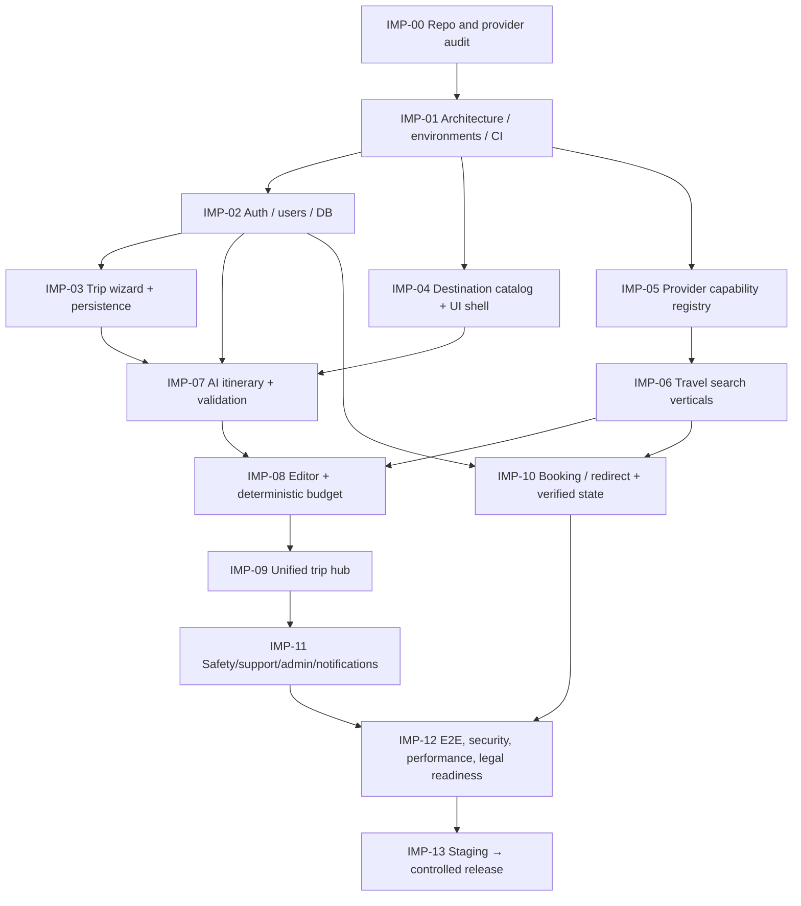

# GHOOMI — Implementation Plan and Release Gates

**Revision:** 1.0 | **Active scope:** Partition 1 (before first deployment) | **Status:** plan only; not work completed | **Source:** 53-page master sections 40–43, 58–60, 79–81 and 82–94. Task IDs, ordering, evidence gates and time ranges are proposed to support agent execution.

## 1. Delivery strategy

Create Ghoomi **as a usable vertical-slice product**, not 55 disconnected static pages. First release provides a reliable travel search/comparison and complete-trip AI planning experience. Every route must have useful function or honest unavailable state. Actual supplier bookings and Ghoomi payment handling require approved integration rights; supplier modes must reflect actual capabilities.

### 1.1 Release language

- **Build target / Partition 1:** accounts, search/discovery (flight, train, bus, cab, stay), holiday wizard, AI editable itinerary, budget, trip hub, food/activity discovery, basic booking handoff or authorized direct flow, safety directory, notifications, support/admin.
- **After deployment / Partition 2:** deeper bookings/payment/refunds, group coordination, consent-based family monitoring/live status, private documents, stronger partner/support operations.
- **Long-term / Partition 3:** intelligent trip recovery, Back-to-Home, SOS system, advanced context-aware AI, public travel/social and marketplace, premium/offline/financial extensions.

**Important:** Partition 1 has P0 and P1 sub-priorities; P1 features still belong to the first-deployment product plan, but provider-dependent portions can only be active to an authorized/truthful depth. Never classify a stubbed checkout as completed.

## 2. Prerequisite dependency graph



**Parallelization:** after architecture/schema/API contracts stabilize, frontend page families and backend modules can be developed concurrently with typed fixtures. Test fixtures are non-production; contract tests govern real backend integration.

## 3. Execution phases — Partition 1 (ACTIVE)

### `IMP-00` — Repository discovery, requirements and external-dependency audit

**Input:** `AGENTS.md`, `rules.md`, all nine specs, master PDF and current codebase.

- [ ] Inventory frameworks/package versions, existing routes, APIs, migrations, services, tests, deployment and secrets/config **names only**.
- [ ] Identify existing working features vs visual mockups and document actual evidence.
- [ ] Confirm tech approach (`ADR-001`); do not replace sound existing stack without approval.
- [ ] Build provider authorization matrix: flight, train, bus, cab, hotel, maps/places, AI, payment, SMS/email; record `PLANNING_ONLY` until evidence permits a stronger mode.
- [ ] Confirm launch geography, initial supported destinations, content image licensing and support operator path.
- [ ] Turn the PRD requirements into a small prioritized feature backlog with clear acceptance tests.
- [ ] Establish a privacy/legal review checklist for India's applicable travel, consumer, privacy, tax and payment obligations.

**Exit gate:** honest current-state report, proposed architecture decision, top risks and an approved first vertical slice. **Never** claim code is implemented because a specification exists.

### `IMP-01` — Foundation: source control, API shell, migrations, design system and CI

**Requirements:** `GHO-P1-QUALITY`, `HOME`; `API` conventions; `DB` baseline.

- [ ] Create or align frontend/backend repo structure without destructive replacement.
- [ ] Establish Tailwind/theming tokens or equivalent existing styles; build accessible components (forms, buttons, alerts, cards, nav, tabs, skeletons).
- [ ] Build responsive shell, landing structure, public routes and guarded authenticated layout.
- [ ] Set up user-approved MySQL 8.4 LTS/InnoDB + reviewed Flyway migrations; ensure isolated dev/test/staging DB. Convert existing schema only after repository audit; do not silently wipe data.
- [ ] Implement standard API error responses, request IDs, structured logging and safe health checks.
- [ ] Configure CI build/lint/types, unit/integration test runner, dependency scanning and `.env.example` variable names.
- [ ] Create staging deployment baseline and non-production test data policy.

**Exit gate:** frontend and backend build; core route renders at mobile/desktop; DB migration + rollback/restore strategy reviewed; test suite runs; secrets absent from client bundle.

### `IMP-02` — Secure accounts, profile, saved travelers (`AUTH`, `PROFILE`)

- [ ] Signup/login/logout, email verification and recovery with secure sessions and rate limits.
- [ ] Profile edit, saved traveler creation/edit/delete, optional emergency contacts (safety module completes later).
- [ ] Permission middleware and security tests for every owner-scope resource.
- [ ] Route guards and return-to-action after signup/login; accessible account forms and error states.
- [ ] Record acceptance of current policy versions where applicable; never collect IDs not required for real booking.

**Exit gate:** two separate test users cannot access each other's profile/trips/travelers; session expiry, account recovery and brute-force rate limits pass; DB persistence verified.

### `IMP-03` — Trip creation and saved drafts (`TRIP`)

- [ ] Implement trip wizard route/date/traveler/budget/preferences DTOs and server validation.
- [ ] Add `Own Vehicle` and `Already Have Stay`; preserve draft without supplier selection.
- [ ] Save, resume, edit, delete/cancel as allowed; version conflicts and ownership checks.
- [ ] Create initial itinerary day scaffolding from date range; store local timezone.
- [ ] My Trips list with draft/planned status and clear continue action.

**Exit gate:** user builds a trip, logs out, returns and sees exact latest owned saved state; invalid dates/counts rejected; unauthorized access rejected.

### `IMP-04` — Destination/food/activity catalog and responsive discovery (`DEST`, `FOOD`, `ACT`)

- [ ] Identify authorized editorial/map/place data sources and image licenses. Publish a narrow verified or clearly curated destination set first.
- [ ] Build destination search, listing, detail and relevant place categories; appropriate filtering/empty states.
- [ ] Add restaurants/attractions/activities to an existing itinerary as **planned items**.
- [ ] Expose sources and freshness; unknown opening times/prices stay unknown.
- [ ] Set admin-controlled editorial updates and input validation.

**Exit gate:** visitors explore meaningful destinations; users save places to a trip; nothing is falsely described as open/current/booked.

### `IMP-05` — Partner adapter platform and capability gates (`PARTNER`)

- [ ] Implement provider registry/health feature flags and four capability modes.
- [ ] Define normalized offer DTO, pricing/basis/freshness, verified source and supplier errors.
- [ ] Add backend adapter interface for `search`, `details`, `quote/reprice`, `handoff`, and later `book` only when authorized.
- [ ] Implement timeouts, rate limiting, retries/circuit breaker, cache TTL and error metrics.
- [ ] Record approved provider access, license terms, sandbox test credentials and launch mode **without placing secrets in documents**.
- [ ] Provide deterministic contract fixtures exclusively in test/dev; deny synthetic production inventory.

**Exit gate:** unapproved provider cannot serve bookable offers; each adapter has contract test and failure isolation; source/status visible to frontend.

### `IMP-06` — Search verticals and comparison (`TRANSPORT`, `STAY`)

Incrementally build shared search/results/detail components then each vertical:

- [ ] Flights: route, date, passengers; results, filters, details, baggage/terms where supplied.
- [ ] Trains: source/destination stations, date, classes, provider rights; avoid unauthorized ticketing claims.
- [ ] Buses: operator, boarding/drop points, seat category and genuine supplier details.
- [ ] Cabs: pickup/drop, local/airport/outstation, quote estimate versus supplier-confirmed label.
- [ ] Own-vehicle route planning and optional user-estimated costs, no booking CTA.
- [ ] Hotels/stays: date/guest/room search, compare, detail and room selection only when source supports it; own stay option.
- [ ] Shared no-results, stale-quote, supplier unavailable, rate-limit and redirect states.
- [ ] All sorting/filters use real data and preserve criteria while navigating.

**Exit gate:** every enabled search category has an honest, functional discovery path and next action. At least one chosen pilot provider category should achieve a tested approved redirect/live search path before claiming a booking-oriented public launch; if none is authorized, limit launch messaging to **travel planning/discovery beta**, not a full booking platform.

### `IMP-07` — AI planning integration and manual fallback (`AI`)

- [ ] Configure approved AI provider (if credentials/terms available) behind backend and request quotas.
- [ ] Create structured itinerary generation DTO and schema validators for dates, activities, time windows, provenance and user constraints.
- [ ] Implement Budget/Balanced/Comfort/Custom preference interpretation and source-grounded suggestions.
- [ ] Add AI-run status/logging (no sensitive raw prompts); errors and retries safely bounded.
- [ ] Implement manual plan creation from empty schedule and optional deterministic template if AI fails.
- [ ] UI shows AI suggestions as editable/not booked and supports regeneration with clear scope.

**Exit gate:** test five-day itinerary includes only intended dates and can be edited/saved; AI errors never block manual trip planning; no artificial live prices or bookings generated.

### `IMP-08` — Itinerary editing and deterministic budget (`EDIT`, `BUDGET`)

- [ ] Add/edit/remove/reorder itinerary items transactionally with concurrency control and accessible controls.
- [ ] Build cost line-item service in integer paise; categories, per-person/total units and source/estimate statuses.
- [ ] Calculate target minus estimates, flags for over-budget and optional emergency reserve.
- [ ] Compare planning modes and category-level budget/quality overrides.
- [ ] Recalculate on traveler, date, offer or activity changes; show stale supplier quotes.
- [ ] Unit-test overflow/currency mismatch/zero/negative/rounding and client/server consistency.

**Exit gate:** editing a plan persists and produces reproducible deterministic correct totals; AI cannot silently change booked services or override cost math.

### `IMP-09` — Unified dashboard and lifecycle (`HUB`)

- [ ] Build My Trips, Trip Hub, itinerary/timeline, budget, selected services, booking/reference/safety panels.
- [ ] Show selected-but-unbooked versus supplier-confirmed or unverified external references.
- [ ] Load/refresh data from server after mutation and maintain clean empty/loading/error states.
- [ ] Support simple `DRAFT → PLANNED → ACTIVE → COMPLETED` lifecycle with explicit transitions; no live GPS implication.
- [ ] Review mobile and accessibility states for a large itinerary.

**Exit gate:** one saved trip provides accurate consistent view across modules and repeat sessions, with no false booking or tracking claims.

### `IMP-10` — Booking handoffs and payment status (`BOOK`, `PAY`)

**Dependencies:** real partner capability/approval and operational readiness. Build UI/contract foundation regardless, but **do not enable chargeable APIs** until integration approvals and tests exist.

- [ ] Design quote/reprice, terms, provider-aware handoff and booking intent state.
- [ ] Approved redirects: open correct provider checkout and clearly state who completes booking; keep external status unverified.
- [ ] Approved direct mode only: verify quote/availability, user accepts final fees/policy, submit idempotent provider request, await verified supplier confirmation.
- [ ] Payment where configured: secured gateway, verified callbacks, independent payment vs booking status, audit and unknown-timeout reconciliation.
- [ ] Support `pending`, `unknown`, `failed` and `confirmed` UX with actual source/reference; no fabricated success state.
- [ ] Add duplicate-action, webhook replay, quote change, payment/booking mismatch and provider downtime tests.

**Exit gate:** no internal `CONFIRMED` record without authoritative supplier evidence; no `SUCCEEDED` payment without verified gateway evidence; redirects remain labeled external; financial operations are auditable and recoverable.

### `IMP-11` — First-release supporting operations (`SAFETY`, `NOTIFY`, `SUPPORT`, `ADMIN`)

- [ ] Emergency contacts, accurate official emergency information and basic user guidance; no automated SOS/location tracking claims.
- [ ] Notification records/in-app views plus configured email/SMS delivery where real provider exists, with failure status.
- [ ] Support ticket create/read/status with trip/booking links and owner/assigned-staff authorization.
- [ ] Admin overview: role-gated users/trips/content/provider state/support tickets and relevant audit trails.
- [ ] Create operational runbook for provider outage, booking/payment uncertainty, urgent support, data incident.

**Exit gate:** user finds help and support, operations staff see only authorized data, important actions are audited, dispatch/notification success is never fabricated.

### `IMP-12` — Pre-launch quality and compliance verification (`QUALITY`)

**Blockers must remain visible in `tracker.md`.**

- [ ] Validate all 17 first-deployment source criteria (master section 43) and PRD acceptance criteria.
- [ ] Run core journey E2E: auth → trip → AI/manual → search → edit → budget → save → reopen → supported handoff / honest unavailable.
- [ ] Verify source-only live claims, auth isolation, role permissions, quote reprice, financial state/idempotency if enabled.
- [ ] Test mobile/desktop and keyboard accessible interactions and loading/empty/error states.
- [ ] Run unit, integration, provider sandbox, security, dependency and regression checks with actual results.
- [ ] Complete privacy/cookie/terms/refund/support disclosure review aligned to actual commercial model; obtain qualified legal review before commercial launch.
- [ ] Test database backup restoration and staging rollback, observe alerts and check on-call/support readiness.

**Exit gate:** written signoff for release readiness; no critical unresolved auth, payment, booking-truth, privacy or source-provenance issues.

### `IMP-13` — Controlled first deployment and follow-up

- [ ] Prepare version tag, migration plan, environment-specific credentials, DNS/TLS, provider feature flags, monitoring and rollback steps.
- [ ] Deploy staging; run smoke tests and approved provider sandbox validations. Release production only after gates.
- [ ] Public messaging matches actual integration modes. If only planning/discovery is validated, call the release **planning/discovery beta**, not an end-to-end direct booking system.
- [ ] Set up customer support intake, incident escalation and privacy-safe analytics.
- [ ] Observe real user journeys; capture bug list and prioritize fixes before Partition 2.

**Exit gate:** measured production smoke test, incident route, feature flags, rollback runbook and documented post-launch metrics. Do not report deployed until deployment succeeded.

## 4. Intended parallel workstreams and ownership (roles, not named people)

| Workstream | Responsibilities | Hand-off contract |
|---|---|---|
| Product/UX | PRD and source alignment, screens, accessibility, microcopy | Requirement IDs, flows, reviewed states |
| Frontend | UI components, routes, forms, states, integration with API | Typed DTOs and responsive acceptance checks |
| Backend/data | Auth, trips, budget, provider gateway, booking status, schema | OpenAPI, migrations and tests |
| AI/integration | Provider mode registry, AI validation, supplier adapters | Source provenance, quotas, failure tests |
| QA/security | Functional, E2E, accessibility, auth-negative tests | Evidence and blocker list |
| DevOps/operations | CI/staging/prod, secrets, backups, monitoring, rollback | Deployment and recovery evidence |

In a small team, one person may cover multiple roles. Parallel work begins after agreement on core DTOs and user flows.

## 5. Suggested milestones (illustrative, not commitments)

| Milestone | Outcome | Dependency |
|---|---|---|
| M0 | Audit, scope, tech and provider capability map approved | None |
| M1 | Foundation/auth/DB/staging and landing functional | M0 |
| M2 | Trip wizard, persistence, destination catalog | M1 |
| M3 | AI manual fallback, itinerary, budget, trip hub | M2 |
| M4 | Core search verticals/authorized partner handoffs | M1/M2 and supplier access |
| M5 | Basic safety/support/admin/notification | M1–M4 |
| M6 | Release hardening, operator readiness, compliant launch | All applicable M0–M5 |

**Scheduling:** choose realistic sprint capacity after repo/team/partner audit. Provider authorization and commercial approvals can dominate elapsed time; time estimates without access information are unreliable.

## 6. Source page inventory coverage

The source enumerates **55 initial page/module entries** grouped into foundation (7), trip/AI (10), transport (14), accommodation (7), food/activities (6), booking/operations (11). `App Flow.md` preserves exact numbering and maps entries to reusable route families. Track coverage at the **feature+flow** level rather than claiming every entry is an independent completed page.

## 7. Explicit post-launch roadmap — not active tasks

### Partition 2 — operational expansion

1. Expand approved flight/train/bus/cab/hotel integrations and accurate booking state synchronization.
2. Add advanced payment recording, gateway events, reconciliation, partner settlements, commissions and supported cancellation/refund flows with explicit consent.
3. Introduce group organizer/member roles, invitations, shared itineraries and per-member permissions.
4. Enable opt-in family monitoring only after explicit consent, location-sharing duration/revocation, recipient verification and realistic browser/OS constraints.
5. Add source-backed live trip events, notifications, protected booking-document storage and advanced support.
6. Build partner self-service and platform operations dashboards once inventory ownership/contractual processes exist.

**Partition 2 release gate:** full financial/source integrity, support escalation, privacy/consent evidence, webhook/idempotency/reconciliation tests and feature flags.

### Partition 3 — intelligent ecosystem

1. Advanced AI travel assistant and current verified event/weather advice.
2. Intelligent trip recovery (source-confirmed disruption → impacted services → alternatives → cost differences → user approval → supported execution).
3. Back-to-Home with user-approved return options, no automatic cancellation/charges.
4. Advanced SOS/trusted-contact coordination with explicit delivery status and no false emergency dispatch claims.
5. Group expense splitting, limited offline essentials, sensitive document wallet subject to review.
6. Opt-in public trips, memories, Ghoomi Explore, moderation, partner marketplace, premiums and advanced analytics.

**Partition 3 release gate:** operational maturity, necessary real provider/safety partnerships, legal/data retention review and validated demand. Do not introduce complexity based only on the number of future feature names.

## 8. Quality gates and source-backed first deployment checklist

The 53-page source section 43 lists 17 conditions. Translate them into evidence:

| Gate ID | Verify |
|---|---|
| `REL-01` | Account registration/login actually work |
| `REL-02` | Trips create/save/reopen correctly |
| `REL-03` | Preferences are stored and applied |
| `REL-04` | AI itinerary or honest manual fallback is useful |
| `REL-05` | Budget arithmetic is correct |
| `REL-06` | Supported transport options can be compared |
| `REL-07` | Supported accommodation can be discovered |
| `REL-08` | Restaurants and activities can be explored |
| `REL-09` | Trips can be customized and changes persist |
| `REL-10` | Unified dashboard shows accurate data |
| `REL-11` | Every enabled booking integration operates as authorized/claimed |
| `REL-12` | Payment state is accurate where payment is integrated |
| `REL-13` | Admin operations are secure and functional |
| `REL-14` | API/provider failures are handled without fake success |
| `REL-15` | Security/privacy and compliance steps are met |
| `REL-16` | Desktop/mobile flows pass functional/accessibility smoke tests |
| `REL-17` | End-to-end core user workflows pass testing |

**Additional safety gates:** backup restore exercised; rollback rehearsed; source/availability/freshness labels correct; zero verified critical cross-account or financial vulnerability; support owner identified; actual partner rights recorded.

## 9. Agent implementation loop

Every agent task should use this template and update `tracker.md`:

```text
Task ID / requirement IDs:
Current inspected behavior:
Target behavior and out-of-scope:
Dependencies, external approval and blockers:
UI and accessibility states:
API contract and data changes:
Auth/consent and privacy implications:
Tests and expected outcomes:
Actual files changed:
Tests run + observed results:
Release mode (planning/redirect/live/direct):
Tracker + memory change log:
Next approved task:
```

**Do not** check work as complete without actual implementation and proof. If an operation requires missing supplier credentials, leave it blocked, implement a truthful supported fallback, and continue independent P0 work.
