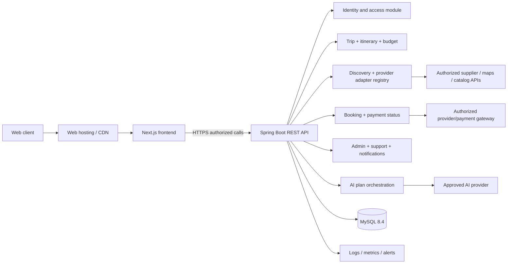
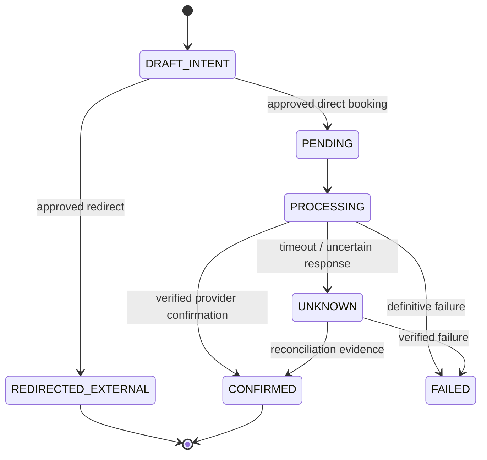

# GHOOMI — Technical Requirements Document (TRD)

**Revision:** 1.0 • **Build target:** Partition 1 (first release) • **Source:** 53-page Ghoomi working-platform master, especially sections 10, 41, 59, 80, 82–94. **Architecture and tooling details here are proposed technical decisions**, not claims of existing implementation or supplier approval.

## 1. Engineering objective and constraints

Implement a trustworthy, production-oriented travel discovery and planning service that saves user-specific trips, generates editable AI itineraries, computes budgets deterministically, and connects to **authorized** provider services through a common contract. The first version must remain useful even when some travel providers do not offer direct-booking access.

**Non-negotiable technical qualities:** secure identity; per-resource authorization; clearly labeled estimate vs verified data; no invented inventory/booking/payment data; accurate persistence; graceful vendor/AI failure; responsive accessible UI; observable operations and restore/rollback plan.

## 2. Proposed stack and architecture decision

### 2.1 Preferred baseline *only for a new/empty repo* (`ADR-001 — Proposed`)

| Layer | Proposed choice | Why / note |
|---|---|---|
| Frontend | Next.js App Router + React + TypeScript | SEO-friendly travel catalog and application UI; keep client/server boundaries clear |
| Styling | Tailwind CSS + accessible primitives | Reusable design system defined in `UI-UX design Brief.md` |
| Backend | Java Spring Boot modular monolith, Spring Web, Validation and Security | Source document suggests Java Spring Boot; suitable domain modules and provider adapters |
| Database | MySQL 8.4 LTS (InnoDB) with Flyway migrations | Approved database; relational trip/booking/financial consistency, JSON only when justified |
| ORM | Spring Data JPA for core transactional entities | Avoid overcomplicated query layers; use explicit SQL for complex reporting |
| Authentication | Spring Security with HTTP-only secure session cookies (recommended), or approved token approach | Never put long-lived secrets in JS-accessible storage; decide cross-domain strategy |
| AI | Backend proxy to approved LLM with structured response schema | Configurable provider; constraints, output validation, budget calculation external to AI |
| Provider APIs | Adapter per vertical/provider behind capability registry | Approved rights, throttling, normalization, source/freshness metadata |
| Background tasks | DB-backed scheduled jobs initially; queue later if needed | Reconciliation, notifications, expiration, cache refresh |
| Object storage | Private encrypted bucket when approved documents are required | V1 may not need sensitive document storage |
| Observability | Structured logs, metrics, trace IDs, centralized error tracking | Booking/AI/provider failures and privacy-safe operation |
| CI/CD | Git/GitHub, backend build/tests, frontend build/lint/types, staging + controlled prod | No direct untested changes to production |

**Important:** source lists React/Next.js, Spring Boot and MySQL/PostgreSQL as **choices**; the user has now specifically selected **MySQL**. If a substantial working React/Vite or Node project exists, inspect it and obtain approval before migration. This pack recommends an architecture for consistency, **not mandatory destructive rewriting**.

### 2.2 Deployment topology



All external supplier and AI secrets are server-only. The UI must not call private supplier APIs directly unless an explicitly approved public client SDK/API model supports it.

### 2.3 Suggested domain module boundaries

`identity`, `profiles`, `destinations`, `trips`, `itineraries`, `budget`, `search`, `providers`, `booking`, `payment-status`, `ai-planning`, `notifications`, `safety-directory`, `support`, `admin`, `audit`.

Each module owns its DTOs/business logic and reaches other modules through interfaces, not direct coupling to provider SDKs or UI state. Monolith until measured operational need justifies service separation.

## 3. Repositories, environments and configuration

Suggested layout if empty:

```text
web/                 # Next.js frontend
api/                 # Spring Boot modules, controllers, services, tests
  src/main/java/...  # domain-focused packages
  src/main/resources/db/migration/  # Flyway SQL
infrastructure/      # deployment templates, observability, scripts
reference/           # source master PDF
AGENTS.md + *.md     # project specs, tracking and rules
```

**Environment separation:** `local`, `test`, `staging`, `production`, with separate DBs/API keys/service accounts. Variables such as `DATABASE_URL`, `SESSION_SECRET`, `AI_PROVIDER_API_KEY`, `MAPS_API_KEY`, `PAYMENT_WEBHOOK_SECRET`, `SUPPLIER_<NAME>_TOKEN` appear only in `.env.example` by name, never with real values. Never log production secrets; prefer secret manager. Turn all provider-sensitive features off by default until validated.

## 4. Technical functional requirements by module

### `API-AUTH` — identity / security (`GHO-P1-AUTH`, `PROFILE`)

Signup/login/logout/password reset/verification; encrypted transport, modern password hashing, rate limiting and secure cookie/session rotation. Authenticated role from server records, not untrusted client claims. Scope trips and related data to owner; admin support access is explicit and audited. Saved traveler records store only needed details until booking requires more.

### `API-TRIP` — planning data (`TRIP`, `EDIT`, `HUB`)

Trip CRUD with version number, trip membership/owner (V1 owner-first), itinerary days/items, selected offers or own arrangements and lifecycle state. Support `draft`, `planned`, `active`, `completed`, `cancelled` with server validation. All mutating endpoints reject concurrent stale revisions with `409 VERSION_CONFLICT` or documented merge policy. No cancellation side effect on paid supplier booking.

### `API-DEST` — destination editorial catalog (`DEST`, `FOOD`, `ACT`)

Destination records and place information including content license/source. Curated data is not “live”; current schedules, restaurant opening hours, maps and prices require appropriate provider/public-data attribution. Pagination, full-text search, filters and cache-control appropriate to source.

### `API-SEARCH` — provider adapter gateway (`TRANSPORT`, `STAY`, `PARTNER`)

Normalize supplier responses while preserving source fields/terms. **Adapter modes:** `PLANNING_ONLY`, `REDIRECT`, `LIVE_SEARCH_EXTERNAL_CHECKOUT`, `DIRECT_BOOKING`. Provider registry stores business authorization/health flags. Filter/sort based on returned values; don't produce fake listings when no supplier is configured. Rate limit, timeout and backoff. Cache permitted read data with TTL and last-checked timestamp, never claim stale responses are live.

### `API-AI` — itinerary suggestions (`AI`, `BUDGET`)

Validate input trip scope, collect destination/POI context only from permitted sources, submit schema-guided prompt via server-only AI key, parse structured output, validate day boundaries and constraints, store run/result provenance and explain unknown assumptions. Regeneration requires explicit target (whole plan or day). If AI fails, return `AI_UNAVAILABLE` plus deterministic/manual starter; do not fill with fabricated supplier facts.

**AI must not be the calculator of record.** `budget` module calculates categories from normalized integer money line items, with estimate provenance and versioning.

### `API-BOOK` — provider booking intent, payment and support (`BOOK`, `PAY`)

A booking intent starts only when the supplier capability permits. Recheck selection (price/availability, terms); require fresh acceptance on changed quotes. For provider redirect: create optional traceable handoff, but status stays `REDIRECTED_EXTERNAL`/unverified without a supported callback. Direct bookings use idempotency keys, stored supplier request/response references, separate booking and payment state machines, verified webhook authenticity, and reconciliation. Do not implement payment collection unless gateway/partner/legal/operational gates pass.

### `API-OPS` — notification, safety, support and admin

Notification dispatch records actual channel statuses; basic local emergency information and emergency contacts only, no V1 SOS automation. Support tickets with status/owner/assignment and privacy controls. Admin APIs use explicit admin policy and audit logs; no global user-data access by ordinary users.

## 5. API contract conventions

**Base path:** `/api/v1`. **Format:** JSON (UTF-8), `snake_case` DB but `camelCase` JSON recommended. **Time:** UTC ISO 8601 in API; local timezone stored with itinerary as IANA timezone when relevant. **Money:** `{ "amountMinor": 189900, "currency": "INR" }`; minor INR units are paise. Use int64, no binary floats. **IDs:** UUID, opaque. **Pagination:** `cursor`/`limit` for collections; filtering encoded safely. **Writes:** validate at boundary; return structured error.

Standard success envelope may be direct JSON; choose once. Standard error:

```json
{
  "error": {
    "code": "PROVIDER_UNAVAILABLE",
    "message": "Search is temporarily unavailable for this provider.",
    "requestId": "req_example",
    "retryable": true,
    "details": []
  }
}
```

**HTTP semantics:** `400` validation, `401` unauthenticated, `403` forbidden, `404` not found (resource-masking policy consistent), `409` version/quote conflict, `422` invalid business constraints, `429` rate limited, `502/503` supplier/AI unavailable. No success on failed side effect. Consumer-facing errors cannot reveal internal secret/provider details.

### 5.1 Endpoint inventory (proposed)

| API group | Method and route | Inputs → outputs | Auth |
|---|---|---|---|
| AUTH | `POST /auth/signup`, `/auth/login`, `/auth/logout`, `/auth/verify`, `/auth/password-reset` | Validated identity → session/result | As appropriate |
| PROFILE | `GET/PATCH /me`, `GET/POST /me/travellers`, `PATCH/DELETE /me/travellers/{id}` | Profile/travelers | User |
| DEST | `GET /destinations`, `/destinations/{slug}`, `GET /places` | Search/filter → sourced catalog | Public |
| TRIP | `GET/POST /trips`, `GET/PATCH/DELETE /trips/{id}` | Saved trip with version/status | Owner |
| TRIP | `GET/PUT /trips/{id}/preferences` | Preferences and plan mode | Owner |
| PLAN | `POST /trips/{id}/plans/generate`, `GET /trips/{id}/plans` | AI request → `aiRunId` + structured plan/status | Owner |
| PLAN | `GET/POST/PATCH/DELETE /trips/{id}/itinerary/...` | Itinerary day/item CRUD | Owner |
| BUDGET | `GET/PUT /trips/{id}/budget`, `POST /trips/{id}/budget/recalculate` | Deterministic items and totals | Owner |
| SEARCH | `GET /providers/capabilities`, `POST /search/{vertical}` | Criteria → normalized offers/status | Public w/rate limit |
| SEARCH | `GET /offers/{offerId}` | Detail + validity, only if backed by allowed source | Public |
| BOOK | `POST /booking-intents`, `POST /booking-intents/{id}/reprice` | Eligible selection → quote + status | Owner, capability gate |
| BOOK | `POST /booking-intents/{id}/confirm`, `GET /bookings/{id}` | Idempotent book + verified state | Owner, direct mode only |
| BOOK | `POST /booking-intents/{id}/redirect` | Approved external handoff | User if persisted |
| PAY | `POST /payments/initiate`, `GET /payments/{id}` | Only when gateway enabled | Owner, feature flag |
| HOOK | `POST /webhooks/{provider}` | Signature-verified provider event | Server-to-server only |
| SAFETY | `GET /safety/resources`, `GET/POST /me/emergency-contacts` | Local info/trusted contact | Public/user as applicable |
| SUPPORT | `POST/GET /support/tickets`, `GET /support/tickets/{id}` | Support tickets | Owner/assigned staff |
| ADMIN | `GET /admin/overview`, `GET /admin/providers`, `/admin/tickets` | Authorized aggregates / workflows | Admin-only |

Endpoints are a **contract proposal**, not proof of an existing API. Document exact OpenAPI DTOs before implementing a production integration.

### 5.2 Sample normalized offer (`API-SEARCH`)

```json
{
  "id": "offer-ref-opaque",
  "vertical": "FLIGHT",
  "providerId": "provider-ref-opaque",
  "providerName": "Configured supplier",
  "capability": "LIVE_SEARCH_EXTERNAL_CHECKOUT",
  "dataStatus": "PROVIDER_LISTED",
  "originCode": "BOM",
  "destinationCode": "GOI",
  "departAt": "2026-12-12T06:30:00+05:30",
  "arriveAt": "2026-12-12T07:50:00+05:30",
  "price": { "amountMinor": 540000, "currency": "INR", "basis": "PER_PERSON" },
  "feeBreakdownAvailable": false,
  "checkedAt": "2026-11-03T08:30:00Z",
  "validUntil": null,
  "termsUrl": null,
  "nextAction": "CONTINUE_AT_PROVIDER"
}
```

**The sample is illustrative only, not a real fare or available itinerary.** No card may show this as live data without configured verified supplier response. Null terms/fees must show `Not provided` and may block direct checkout.

### 5.3 Sample trip and AI plan DTOs

```json
{
  "tripId": "uuid",
  "version": 2,
  "title": "Goa holiday",
  "origin": { "placeId": "verified-place-id", "label": "Mumbai" },
  "destination": { "placeId": "verified-place-id", "label": "Goa" },
  "startDate": "2026-12-12",
  "endDate": "2026-12-16",
  "timezone": "Asia/Kolkata",
  "travelerCount": 4,
  "planMode": "BALANCED",
  "budget": { "amountMinor": 3000000, "currency": "INR" },
  "status": "DRAFT"
}
```

AI response schema (conceptual): `runId`, `status`, `sourceType=AI_SUGGESTION`, `days[{date,items[{title,category,plannedStart,plannedEnd,estimatedCost,placeRef?,verificationStatus,notes}]}]`, `warnings[]`. Do not allow AI to emit a `CONFIRMED_BOOKING` field.

## 6. Booking/payment state transitions and reconciliation



**Payment state:** `NOT_STARTED/INITIATED/PENDING/SUCCEEDED/FAILED/UNKNOWN`. Booking cannot become confirmed merely because payment succeeded; payment cannot become succeeded merely because provider booking exists. If a redirect has no approved callback or user-verifiable import, keep the record unverified.

Provider webhooks: authenticate/signature validate → dedupe provider event ID → store receipt → enqueue/execute idempotent processor → lock and transition allowed records → audit → notify and expose verified result. Unknown timeout: query supplier/gateway for actual status before any retry. Background reconciliation must not be silently skipped for financial systems.

## 7. AI architecture and safety contract

1. Gather trip input from authorized user record; redact unnecessary PII.
2. Retrieve only allowed/attributed editorial content and partner listings. Do not use LLM text as provider inventory.
3. Build structured prompt specifying dates, cities, pace, constraints, duration, budget and expected JSON schema.
4. Request from approved AI vendor with timeout, bounded token/cost limits and no secrets exposed.
5. Parse and validate strict schema, dates, time clashes, basic travel feasibility, currency fields and known source limitations.
6. Flag unsourced facts/estimated costs. Reject/repair invalid records instead of inventing confirmations.
7. Store AI-run metadata (provider/model/version, source snapshot references, duration, status, no secret raw prompts or excessive personal data).
8. Accept user edits as the source of truth; maintain versioned trip plan.
9. On service failure return manual editor/template. Budget values always recomputed with the deterministic finance service.

**AI quality tests:** valid five-day plan, no extra dates, poor/unknown locations, budget below plausible minimum, traveler preference changes, cancellation, timeouts, output malformed or context missing. Never silently suggest unavailable tickets or hotels as bookable.

## 8. Relational data contract and migrations

Primary data model is documented in `Backend Schema.md`: identity/profiles/travelers, destinations/places, partners/offers, trips/members, itinerary days/items, budget lines, AI runs, booking intents/verified bookings, payment attempts and provider events, safety contacts, support, notifications and audit. Use MySQL/InnoDB primary/foreign keys; indexed owner/trip lookups; version/concurrency columns; strict states and source timestamps; audit sensitive changes. Migrate schema with MySQL-compatible Flyway migrations and test forward migrations on empty and populated staging DB. Use Java-generated UUID strings in `CHAR(36)` ASCII/binary fields, UTC `DATETIME(6)` and InnoDB `FOREIGN KEY` constraints; avoid PostgreSQL-specific constructs such as `JSONB`, `TIMESTAMPTZ`, `gen_random_uuid()` and partial indexes.

## 9. Security, privacy, consent and compliance

- HTTP TLS enforced, CORS limited to actual origins, secure cookies, CSRF defense for cookie-auth mutating requests, session expiry and revocation.
- Password hashing with approved modern algorithm, credential throttling, verification/reset token single-use or revocation.
- Object-level authorization: users can see only own trips/travelers/bookings; no IDOR via guessed UUID. Admin/support have least privilege and audit.
- Input validation and output encoding; SQL parameterization; safe file upload restrictions only where docs are enabled.
- Optional location data is off by default in V1; Partition 2 consent is explicit/time-limited/revocable and GPS/OS limits are visible.
- No raw payment card data in Ghoomi DB. Processor token/reference only where approved. No government ID collection absent required booking purpose.
- Appropriate India privacy, IT, e-commerce, payment and travel obligations need qualified review before launch; source PDF explicitly marks this as necessary. No template policy alone proves compliance.
- Private logs must not include traveler PII, location histories or payment secrets. Encrypt at rest as available; backups access-controlled and restore-tested.

## 10. Nonfunctional requirements (proposed acceptance targets)

| Attribute | Proposed engineering gate (validate via load/test plan) |
|---|---|
| Availability | Staging monitoring and error budget; production target selected after provider SLA review |
| API latency | Internal CRUD p95 < 500ms under an agreed pilot load; vendor calls separately timed/bounded |
| Provider timeouts | Per-provider configurable bounded timeout + circuit breaker; failure isolated from trip saves |
| Reliability | No duplicate booking/payment for repeated same idempotency key; safe unknown state |
| Data integrity | All trip/budget values persist and respect ownership/version |
| Accessibility | WCAG 2.2 AA-oriented core user flows and keyboard testing |
| Security | Zero known critical/high exploitable auth/financial issues at launch; threat-model review |
| Data recovery | Documented/tested backup restoration; choose RPO/RTO with operator later |
| Cross-device | Chrome/Firefox/Safari responsive smoke tests at mobile/tablet/desktop sizes |
| AI expense | Per-request token/rate limits and instrumentation for model spend; no uncapped retries |

These are **planned targets**, not certified service levels or performance already measured.

## 11. Testing strategy and evidence

- **Unit:** validators, money arithmetic, itinerary conflict detection, status transitions, mode gates.
- **Integration:** migrations, repository queries, auth/session, provider adapter contracts, AI schema parser, webhook signature/idempotency, notification events.
- **E2E:** signup → create 5-day Mumbai/Goa trip → AI/manual plan → edit → budget → save → reopen → provider-verified booking path or truthful restricted state.
- **Security negatives:** user A cannot read/edit user B trip, traveler, ticket, payment, support; admin role restrictions; expired/replayed reset links; malicious inputs.
- **Failure:** supplier timeout, stale quote, AI failure, payment unknown, repeated webhook, DB constraint violation, UI offline reconnect.
- **Release:** staging deployment, regression suite, responsive review, accessibility review, backup restore, rollback exercise, monitoring/alert operator.

## 12. CI/CD, monitoring and operational workflows

Pipeline: PR checks (format/lint/type/build/test/scan) → reviewed merge → staging deploy + migration smoke tests → E2E and provider sandbox tests → release gate → version-tagged production deploy → monitor and rollback on critical regression. Use feature flags for money/provider-dependent actions. Health and metrics endpoints must not expose PII/secrets. Key signals: app errors, signup success, trip save failures, AI failures, provider response quality/latency, quote mismatch, booking unknowns, payment mismatches, notification delivery and support escalation.

## 13. External provider readiness matrix (must be filled from reality)

| Vertical/provider | Approved access | Data contract reviewed | Sandbox tested | Payment/booking rights | Launch mode |
|---|---|---|---|---|---|
| Flights | **Unverified** | No | No | Unknown | `PLANNING_ONLY` until proof |
| Trains | **Unverified** | No | No | Unknown/regulated | `PLANNING_ONLY` until proof |
| Buses | **Unverified** | No | No | Unknown | `PLANNING_ONLY` until proof |
| Cabs | **Unverified** | No | No | Unknown | `PLANNING_ONLY` until proof |
| Hotels | **Unverified** | No | No | Unknown | `PLANNING_ONLY` until proof |
| Maps/places | **Unverified** | No | No | N/A | Curated content until authorized source |
| AI provider | **Unverified** | No | No | N/A | Manual planning fallback until configured |
| Payment gateway | **Unverified** | No | No | Unknown | Disabled until approved |

**Rule:** only change a row to a stronger launch mode with real credentials/rights, tested responses, current terms and recorded evidence; the table's `PLANNING_ONLY` is a safe default, not proof that the category's curated content has already been implemented.

## 14. Future architecture boundaries

Partition 2 introduces verified provider webhooks/settlement workflows, group roles and consent, live update/event ingestion, private documents and partner portal. Partition 3 introduces event-driven disruption graph, approved action orchestration, SOS partners, offline sync, public moderation and advanced financial operations. **Design extendable tables/interfaces now; do not prematurely deploy the future subsystems.**

## 15. Definition of technical done

No feature is done merely because code compiles. It must satisfy mapped `GHO-P1-*` acceptance criteria and relevant `FLOW-*` journeys; include tests with actual results, authorized supplier truth labeling, accessibility, secure storage/authorization, clean migration and tracker evidence. Anything blocked by provider access remains `Blocked` or `Planning-only`, never `Implemented/direct booking`.
